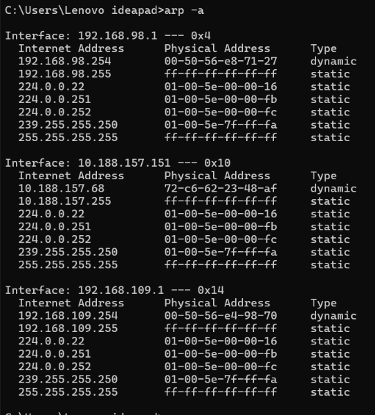
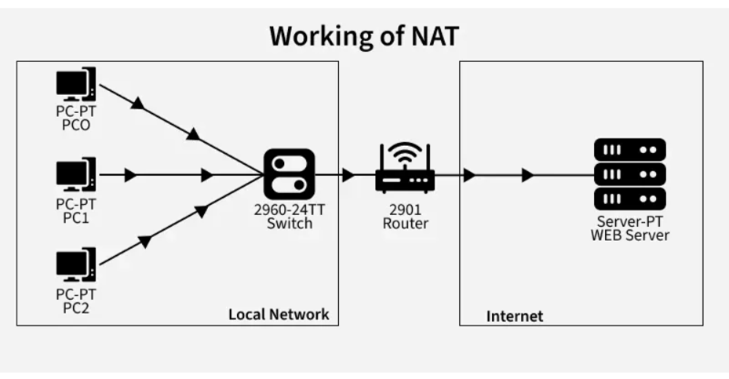
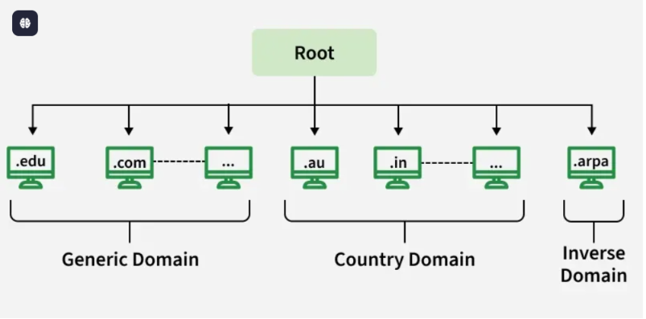
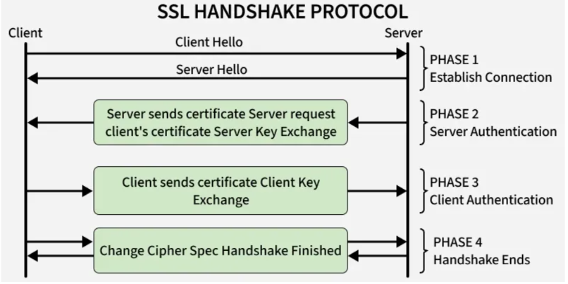

## reference
https://viettuans.vn/broadcast-domain-la-gi?srsltid=AU7gw4WlermRxj_9lEru7wxzUoOJNFd4M_Pn6SGNjX7sQSqWa-fHpXRn

https://www.geeksforgeeks.org/computer-networks/what-is-broadcast-domain/

https://www.geeksforgeeks.org/computer-networks/arp-protocol/

https://www.geeksforgeeks.org/computer-networks/network-address-translation-nat/

https://www.geeksforgeeks.org/computer-networks/domain-name-system-dns-in-application-layer/

## Broadcast Domain
Broadcast domain là một phân vùng trong mạng máy tính , gói tin được gửi đi sẽ được nhận bởi các thiết bị trong cùng một Broadcast domain. Router chính là thiết bị giới hạn và tạo ra Broadcast domain (nó nằm ở ranh giới giữa các Broadcast domain). Mỗi interface của router tương ứng với một Broadcast domain.

The broadcasts sent by one device are kept in a broadcast domain and are not sent to other devices that are part of another broadcast domain. By default, the available ports on a hub or a switch are part of the same broadcast domain. The routers make the separation of LAN into multiple broadcast domains. The available ports on a router are not part of the same broadcast domain and no broadcasting is made by routers from one domain to another.

## ARP
Hoạt động ở Data link (layer 2) trong mô hình OSI. Mục đích của nó là map IP từ tầng 3 với địa chỉ MAC tương ứng của mối device.

Resolves IP addresses to MAC addresses for local communication

Works only within the same broadcast domain (LAN)

### ARP Cache
A temporary storage table maintained by a device.

Stores recently resolved IP-to-MAC address mappings.

Reduces network overhead by avoiding repeated ARP requests.

cmd: `arp -a`

| Cột | Cách đọc |
| --------- | --------- |
| `Interface`    | Giao diện mạng mà bảng bên dưới thuộc về   |
| `Internet Address`   | Địa chỉ IPv4 được ánh xạ   |
|`Physical Address`  | MAC address tương ứng  |
| `Type`   | Cách entry được phân loại: `dynamic` hoặc `static`  |

**ARP Request**

ARP request sẽ gửi request đến tất cả các thiết bị trong cùng một Broadcast Domain. Chỉ được gửi khi MAC address không có trong ARP cache table.

## Traceroute
Traceroute is a network diagnostic tool used to track the path that data packets take from one computer to another across a network (like the internet). It helps in determining the route and measuring the transit delays of packets over the internet. It's especially useful for identifying network issues such as slow response times, network congestion, or routing problems.

Đọc hiểu kết quả câu lệnh: `tracert google.com`

1.Hop Number: mỗi hub là 1 router hay thiết bị định tuyến

2.IP Address: The IP address of the router or device handling the packet at that hop.

3.Round-Trip Time (RTT): The time it took for a packet to reach that hop and return to the source. Traceroute typically measures three RTTs per hop.

4.Timeout or Asterisk (*): If a hop is not responding, it will show as * * * indicating a timeout or refusal to respond to the traceroute request.

## NAT
Network Address Translation (NAT) allows multiple devices in a private network to access the internet using a single public IP address. It helps conserve IPv4 addresses and hides internal systems for added security.

Cách hoạt động:

1. Thiết bị gửi request sẽ được chuyển tiếp đến router có cấu hình NAT

2. Router thay thế private IP with its public IP và gán với một port 

3. lưu trữ vào NAT table

4. Khi nhận response từ server thì NAT sử dụng các entry lưu trữ trong NAT tables để gửi đến internal device.

NAT tables gồm:

Inside Local – địa chỉ thật của máy trong LAN;

Inside Global – địa chỉ công khai mà router "mượn" thay cho máy nội bộ khi ra Internet

Outside Global – địa chỉ thật của server bên ngoài:

Protocol – TCP / UDP / ICMP (vì port của TCP ≠ port của UDP, phải phân biệt).

State / Timer – trạng thái kết nối và thời gian sống 

| **Inside Local**   | **Inside Global** | **Outside Global** | **Protocol** | **State**   |
| :----------------- | :---------------- | :----------------- | :----------- | :---------- |
| 192.168.1.10:54321 | 203.0.113.5:40001 | 142.250.4.100:443  | TCP          | ESTABLISHED |

để ý phần port được gán ở **Inside Local** và **Inside Global** vì router ở biên ngoài sẽ dựa vào cái port này để xác định được device nào cần nhận response khi target trả response về.

## DNS

Cách hoạt động:

1. user enter a domain name

2. local cache check: Check browser or OS

3. DNS Resolver: Các resolver công cộng như `8.8.8.8` (Google), `1.1.1.1` (Cloudflare).Nếu ở đây chưa có đáp án nó lên cấp cao hơn để hỏi.

4. Root Server Query: The resolver queries a root server, which points to the correct TLD server.

5. TLD Server Response: The TLD server directs the resolver to the domain’s authoritative server.

6. Authoritative Server Response: The authoritative server returns the actual IP address.

7. Final Response: The resolver sends the IP back to the user, and the browser connects to the server.

### DNS Record Types
A Record: Maps a domain name to its corresponding IPv4 address.

CNAME Record: Creates an alias that points one domain name to another domain name.

MX Record: Specifies the mail server responsible for receiving emails for a domain.

TXT Record: Stores text information used for verification and email authentication purposes.

## SSL

Secure Sockets Layer (SSL) is an Internet security protocol that encrypts data to ensure secure communication between devices over a network.

