## Reference

https://medium.com/@0xAwali/http-parameter-pollution-in-2024-32ec1b810f89

https://hacktricks.wiki/en/pentesting-web/parameter-pollution.html

## Phân cách các tham số
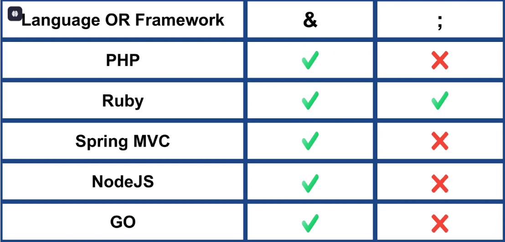

## PHP 8.3.11 AND Apache 2.4.62

1. Ignore anything after %00 in the parameter name :`?name%00hehe=Test` thì kết quả là `name=Test`
2. Handle name[]=one as array .
3. handle `name=one&name=two` as `name=two` .
4. handle `name=one&name[]=two` as array .
5. handle `name[]=one&name=two` as name=two.
- mức 4 và 5 là PHP sẽ chọn cái sau cùng
6. handle `name[]=one&name[]=two` as array .
7. handle `GET` Request `name=one` AND body `name=two` as `name=one` .
8. handle `POST` Request `name=two` AND body `name=one` using `$_GET` as name=two .
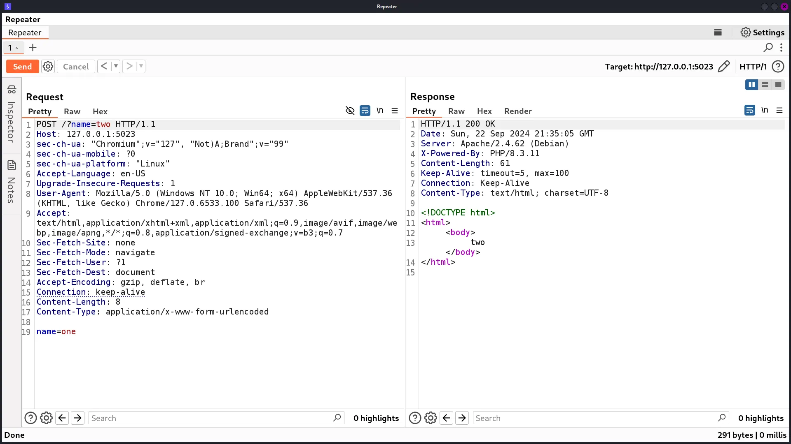
9. handle `POST` Request name=two AND body name=one using `$_POST` as name=one .


### Tóm tắt
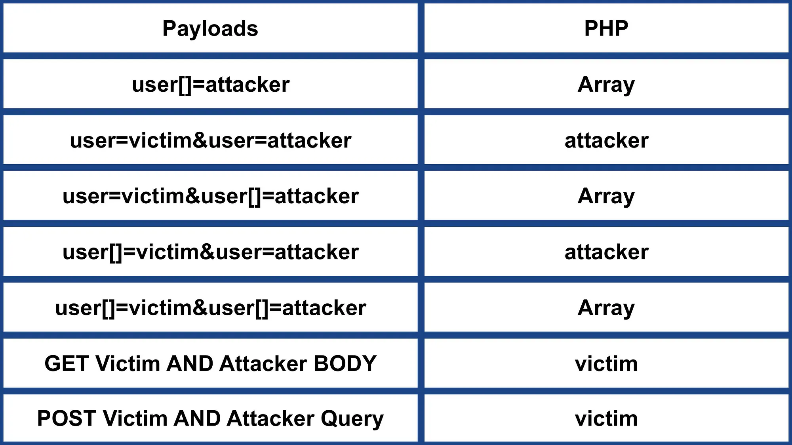

## Ruby 3.3.5 AND WEBrick 1.8.2
```ruby
require 'webrick'

def getPOC(query_param)
  "<html><body>#{query_param}</body></html>"
end

server = WEBrick::HTTPServer.new(Port: 8000)

server.mount_proc '/' do |req, res|
  param = req.query['name']
  result = getPOC(param)
  res['Content-Type'] = 'text/html'
  res.body = result
end

trap 'INT' do server.shutdown end
server.start
```

1. Not Recognized name[]=one 
2. handle name=one&name=two as name=one .
3.  handle name=one&name[]=two as name=one .
4. handle name[]=one&name=two as name=two .
5. Not Recognized name[]=one&name[]=two .

Các mức trên chỉ ra rằng, Ruby không chấp nhận [] ở tham số và  chỉ chấp nhận giá trị tham số ĐẦU TIÊN mà nó gặp

6. handle GET Request name=one AND body name=two as name=one .
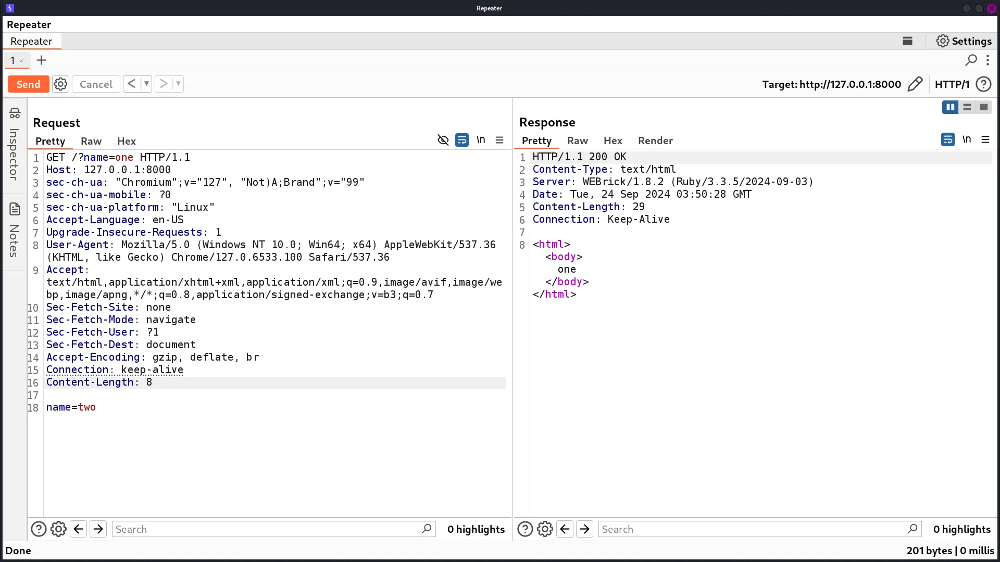

7. handle POST Request name=two AND body name=one as name=one
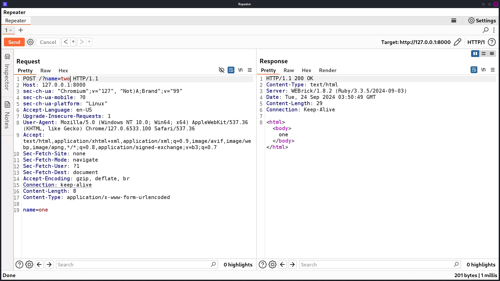

### Tóm tắt
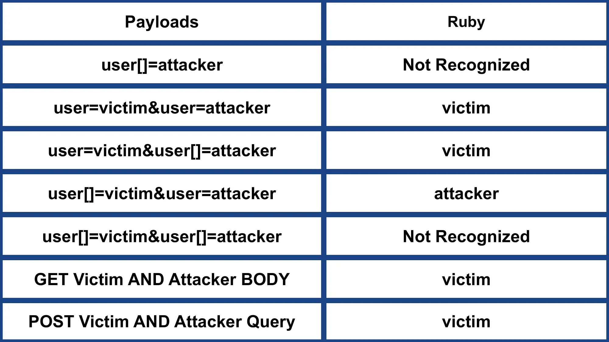

##  Spring MVC 6.0.23 AND Apache Tomcat 10.1.30
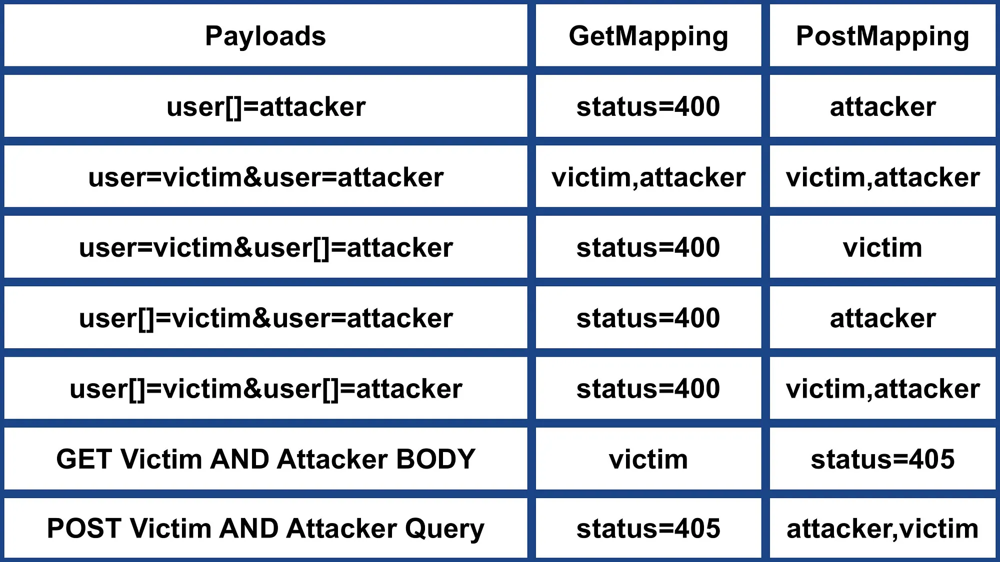

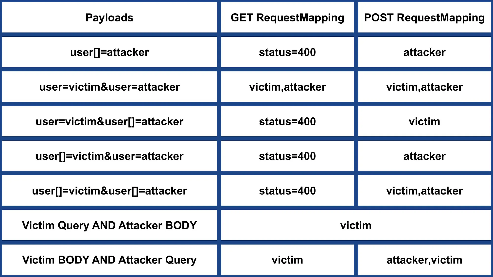

## NodeJS 20.17.0 AND Express 4.21.0
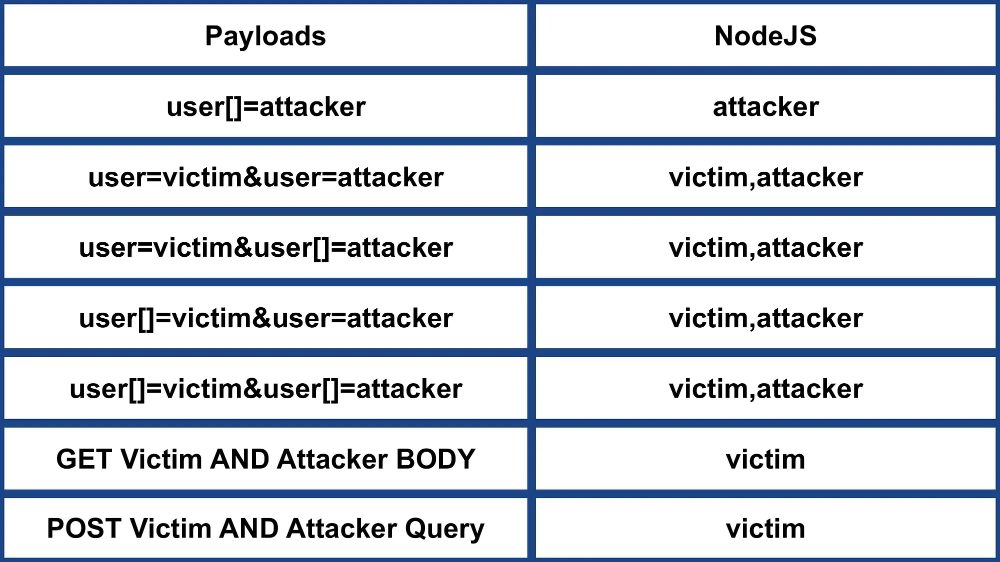

## GO 1.22.7
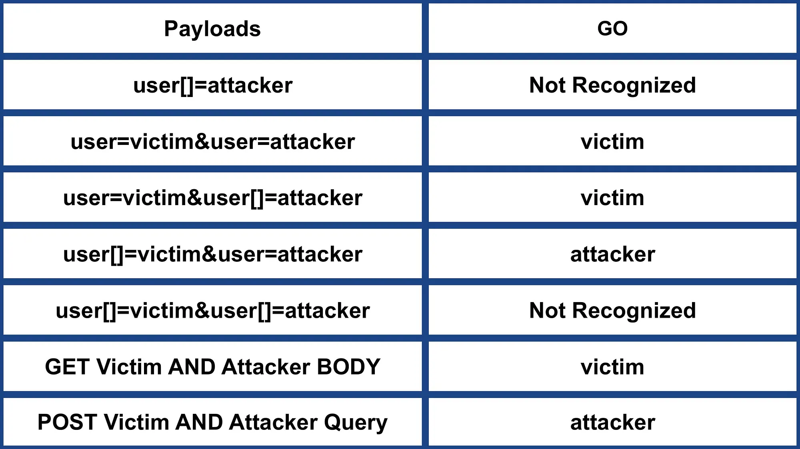

## Python 3.12.6 AND Werkzeug 3.0.4 AND Flask 3.0.3


## Python 3.12.6 AND Django 4.2.15
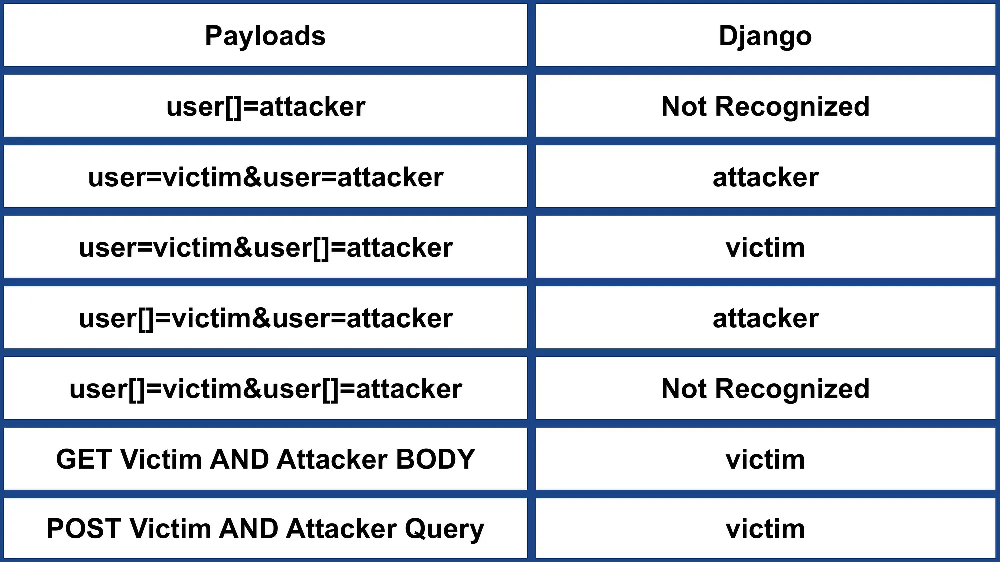

## Python 3.12.6 AND Tornado 6.4.1


## 📝🧵 KEYPOINTS :-
### 1️⃣ PHP 8.3.11 AND Apache 2.4.62

1️⃣.1️⃣ Ignore anything after %00 in the parameter name .

1️⃣.2️⃣ Handle name[] as array .

1️⃣.3️⃣ _GET not meaning GET Method .

1️⃣.4️⃣ Prefer the last parameter .

### 2️⃣ Ruby 3.3.5 AND WEBrick 1.8.2

2️⃣.1️⃣ Uses the & and ; delimiters to split parameters .

2️⃣.2️⃣ Not Recognized name[] .

2️⃣.3️⃣ Prefer the first parameter .

### 3️⃣ Spring MVC 6.0.23 AND Apache Tomcat 10.1.30
3️⃣.1️⃣ POST RequestMapping == PostMapping & GET RequestMapping == GetMapping .

3️⃣.2️⃣ POST RequestMapping & PostMapping Recognized name[] .

3️⃣.3️⃣ Prefer name if name AND name[] existing .

3️⃣.4️⃣ Concatenate parameters e.g. first,last .

3️⃣.5️⃣ POST RequestMapping & PostMapping Recognized query parameter with Content-Type .

### 4️⃣ NodeJS 20.17.0 AND Express 4.21.0

4️⃣.1️⃣ Recognized name[] .

4️⃣.2️⃣ Concatenate parameters e.g. first,last .

### 5️⃣ GO 1.22.7

5️⃣.1️⃣ NOT Recognized name[] .

5️⃣.2️⃣ Prefer the first parameter .

### 6️⃣ Python 3.12.6 AND Werkzeug 3.0.4 AND Flask 3.0.3

6️⃣.1️⃣ NOT Recognized name[] .

6️⃣.2️⃣ Prefer the first parameter .

### 7️⃣ Python 3.12.6 AND Django 4.2.15

7️⃣.1️⃣ NOT Recognized name[] .

7️⃣.2️⃣ Prefer the last parameter .

## 8️⃣ Python 3.12.6 AND Tornado 6.4.1
8️⃣.1️⃣ NOT Recognized name[] .

8️⃣.2️⃣ Prefer the last parameter .


