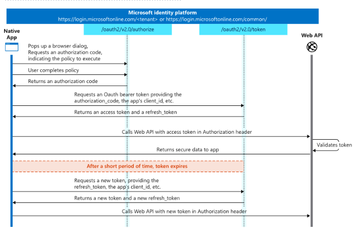

## reference
https://hackerone.com/reports/1074047

https://learn.microsoft.com/en-us/entra/identity-platform/v2-oauth2-auth-code-flow

https://darutk.medium.com/diagrams-and-movies-of-all-the-oauth-2-0-flows-194f3c3ade85

## OAuth 2.0 Flows


1. Lấy authencation code
- Khi người dùng chọn login với microsoft thì sẽ có một cửa sổ hiện lên để người dùng login tài khoản microsoft và cấp quyền cho trang web truy cập tài nguyên 
- Sau khi login thành công sẽ được `oauth2/v2.0/authorize` trả về một `authencation code`.

- request khi người dùng nhấn `login with microsoft`
```
// Line breaks for legibility only

https://login.microsoftonline.com/{tenant}/oauth2/v2.0/authorize?
client_id=00001111-aaaa-2222-bbbb-3333cccc4444
&response_type=code
&redirect_uri=http%3A%2F%2Flocalhost%2Fmyapp%2F
&response_mode=query
&scope=https%3A%2F%2Fgraph.microsoft.com%2Fmail.read
&state=12345
&code_challenge=YTFjNjI1OWYzMzA3MTI4ZDY2Njg5M2RkNmVjNDE5YmEyZGRhOGYyM2IzNjdmZWFhMTQ1ODg3NDcxY2Nl
&code_challenge_method=S256
```
giải thích một số tham số chú ý:
- `client_id`: dev đăng kí trước với microsoft. Hệ thống của microsoft sẽ tự động sinh ra một mã định danh duy nhất (dạng chuỗi UUID) cho ứng dụng đó.
- `redirect_uri`: redirect_uri của web application đang sử dụng phương thức đăng nhập này. Khi Microsoft xác thực người dùng thành công thì tham số 
- `response_type`: chỉ định loại response mà web application mong muốn
- `scope`: chỉ định phạm vi dữ liệu của user mà web application muốn truy cập.
- `state`: lưu trữ một giá trị duy nhất  không đoán được . Được liên kết với session làm việc hiện tại sẽ được trả về cùng `authorization code` , nó hoạt động như một mã `CSRF`

`authorization code` và `state` sẽ được gửi về địa chỉ này. Cái địa chỉ này phải match 100% với cái địa chỉ đã đăng kí 

- response nhận về:
```
HTTP/1.1 302 Found
Location: {Redirect URI}
  ?code={Authorization Code}  // - Always included
  &state={Arbitrary String}   // - Included if the authorization
                              //   request included 'state'.
```

2. tra đổi authencation code lấy access_token.
- gửi 1 request đến `oauth2/v2.0/token`kèm theo các tham số như `client_id` , `authencation_code` , ... để lấy `access_token`

3. truy cập tài nguyên
- trang web sử dụng `access_token` nhận được để truy cập vào web API để lấy thông tin về người dùng đem về sử dụng 


## Các điểm yếu xảy ra.
### 1. Implicit Grant Flow
Loại xác thực này hoạt động là sau khi user login xong thì response được trả về sẽ là `access_token` thay vì `authencation_code`.

Dấu hiệu: `response_type = token` chứ không phải là code. 

### 2. Lỗ hổng ở Dịch vụ OAuth
thao túng `redirect_uri`


