##  Lý thuyết
API recon bằng cách đọc tài liệu về API , các đường dẫn có thể `/api` ,  `/swagger/index.html` , `/`.  `Burp Scanner` có thể đươc sử dụng để crawl the API.

Lúc recon thì chú ý một số api sẽ chỉ `v2` , `v3` , ... Đây là chỉ các version cảu api thì có thể thử search thêm các version thấp hơn như `v1` vì nó có thể là bản outdate nhưng vấn hoạt động và chưa update cơ chế an toàn

Tìm kiếm api ở các file js có thể sử dụng `JS Link Finder` đã có sẵn ở `Bapp`.

- `PATCH` được sử dụng để update một phần tài nguyên .
-  `PUT` update toàn bộ tài nguyên 
- `POST` tạo mới một tài nguyên
- `OPTIONS` Truy xuất thông tin về các loại phương thức yêu cầu có thể được sử dụng.

Recon các tham số ẩn bằng **Param miner** BApp. Nguyên nhân có các tham số ẩn này có thể là framework tự động mapping tham số được gửi lên với các field nộ bộ của object trong code.

Xác định các method mà một API endpoint hỗ trợ sử dụng **built-in HTTP verbs** list in Burp Intruder.

Xác định content type và API hỗ trợ , có thể thay đổi định dạng content-type để xem hành vi của trình duyệt.
### Server-side parameter pollution

https://hacktricks.wiki/en/pentesting-web/parameter-pollution.html

https://medium.com/@0xAwali/http-parameter-pollution-in-2024-32ec1b810f89

Cách parse tham số dựa trên công nghệ , framework mà target sử dụng.

Parameter Parsing: Flask vs. PHP:
- Flask: query string a=1&a=2 thì sẽ chọn giá trị đầu tiên
- PHP(on Apache HTTP Server): query string a=1&a=2 thì sẽ chọn cái cuối cùng


## Lab
### 1. Lab: Exploiting an API endpoint using documentation

Tìm kiếm API document . `GET /api/`

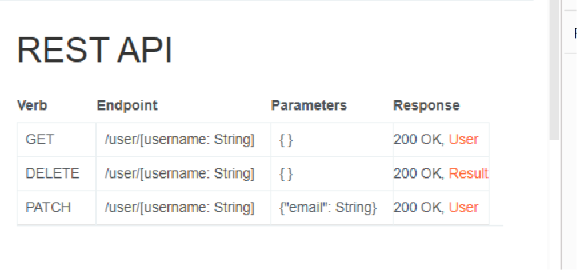

theo Rest API thì `PATCH` được sử dụng để update một phần tài nguyên . `PUT` update toàn bộ tài nguyên , `POST` tạo mới một tài nguyên

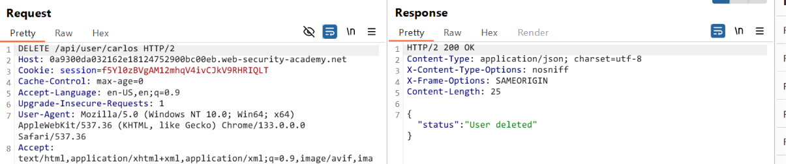

### 2. Lab: Finding and exploiting an unused API endpoint

Để mua được hàng khi sản phầm của có giá thành là 0đ . Trong history request bắt được 1 request lấy giá thành từ API. **/api/products/1/price**
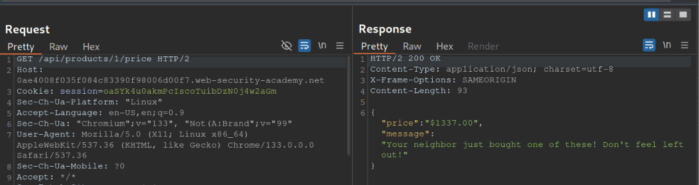
Thực hiên kiểm tra bằng intruder và bằng **HTTP verbs** wordlist thì thấy nó hỗ trợ **PATCH** - một method hỗ trợ cập nhật 1 phần tài nguyên
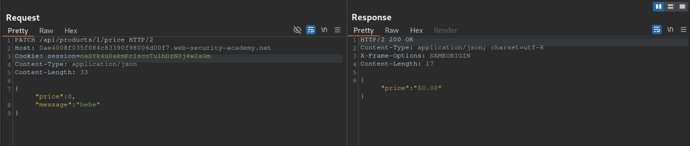
Cập nhật được tài nguyên thành công. Sau khi cập nhật thành công thì thực hiện mua hàng . 

Nguyên nhân: BAC ở phía Rest API khi mà user nào cũng cập nhật được tài nguyên. 

### 3. Lab: Exploiting a mass assignment vulnerability

Check trong tab history thấy 1 request **GET /api/checkout** có vẻ đang lấy thông tin từ API để hiện ra.
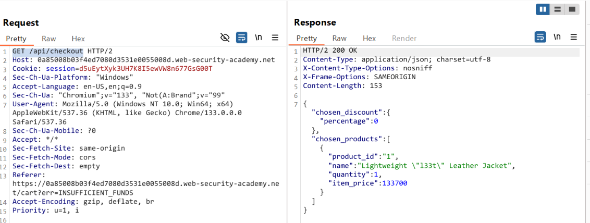

Thực hiện kiểm tra bằng intruder thì thấy nó hỗ trợ POST method

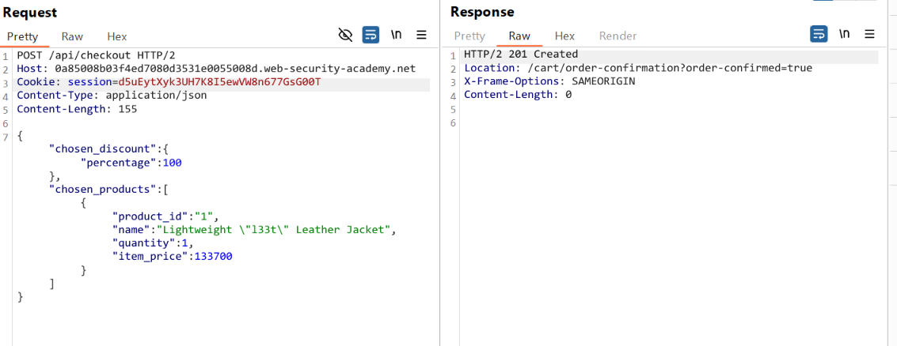
Thấy cập nhập thành công . Vẫn là lỗi BAC và blind param (từ động mapping các tham số user gửi lên các object trong mã nguồn)

### 4. Lab: Exploiting server-side parameter pollution in a query string

Thực hiện bắt request change passwd
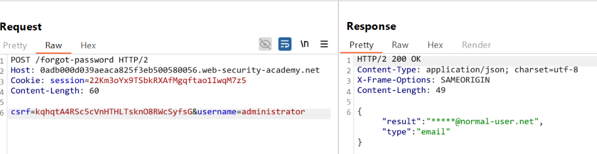

Nhìn vào đoạn response trên thì có thể đoán BE sử dụng `username` để truy vấn email của user trong db.
Test:
-  Thực hiện thêm các trường khác (nhận thấy vẫn như vậy)
- thực hiện double giá trị `username` thì nhận thấy nó chọn giá trị sau cùng thì có thể đoán ra có thể phía BE được xây dựng trên nên PHP.
- thực hiện chèn `#` vào trong chuỗi query thì nhận thấy **báo lỗi** ==> đoán ra phía BE thực hiện nối chuỗi input của user trực tiếp vào câu truy vấn để gửi request lên internal API. 
```python
const username = request.body.username;

const apiUrl =
    `/api/user/forgot-password?username=${username}&field=email`;

const response = await fetch(apiUrl);
```
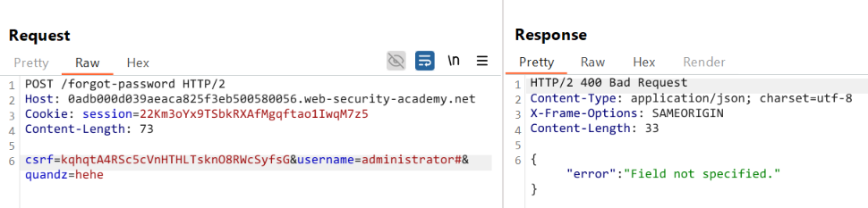
từ báo lỗi trên thì có thể thây là có tham số `field` trong chuỗi query.

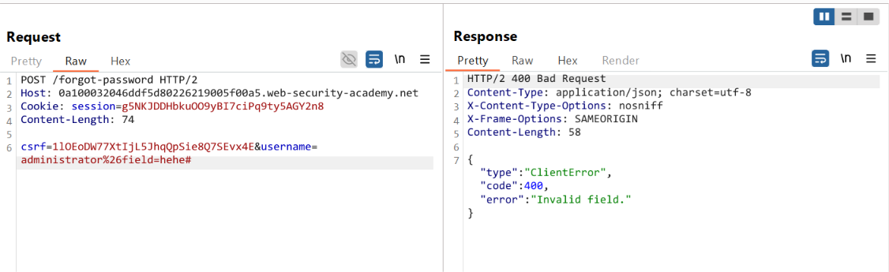
Có thử test các giá trị mà `field` có thể nhận và nhận thấy internal API có kiểm tra giá của trường này. Thực hiện fuzzing để xem nó nhận các giá trị nào. 
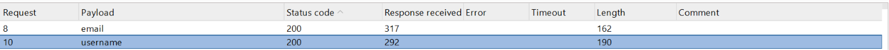
Nó nhận các 2 giá trị `email` và `username`.
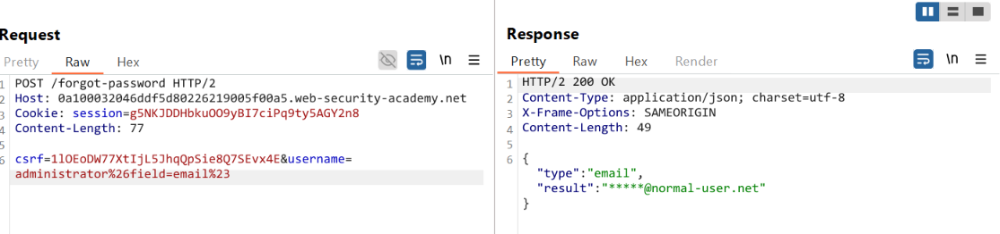

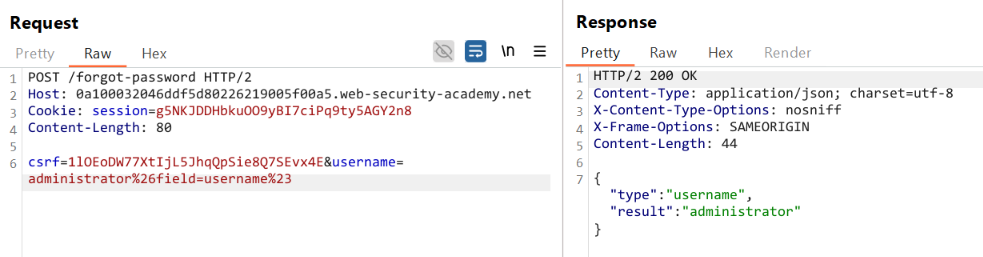

Có thể đoán giá trị của `field` là ám chỉ thứ sẽ được trả về trong db . Mục tiêu là phải leak được reset token để change passwd.

Nhận thấy có 1 tham số **window.location.href = `/forgot-password?reset_token=${resetToken}`;** trong file https://0a100032046ddf5d80226219005f00a5.web-security-academy.net/static/js/forgotPassword.js thì có thể thử giá trị `field` bằng `reset_token`.

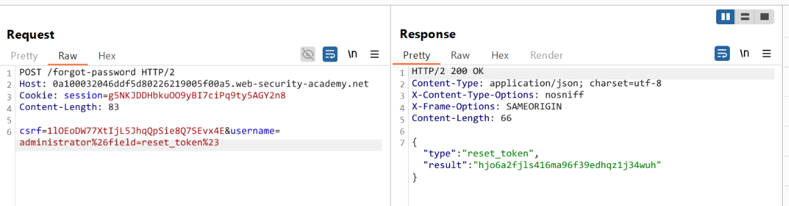

thực hiện change passwd mà xóa tài khoản. 

### 5. Lab: Exploiting server-side parameter pollution in a REST URL
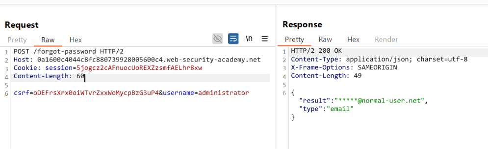
Bắt request change passwd.

Thực hiện chèn các kí tự đặc biệt `#` thì bị báo lỗi routing.Chứng tỏ phía BE thực hiện nối chuỗi trược tiếp input user nào câu truy vấn để gửi request nê việc gửi các kí tự nội bộ sẽ làm cho nó bị thay đổi cấu trúc dấn đến định tuyến sai.
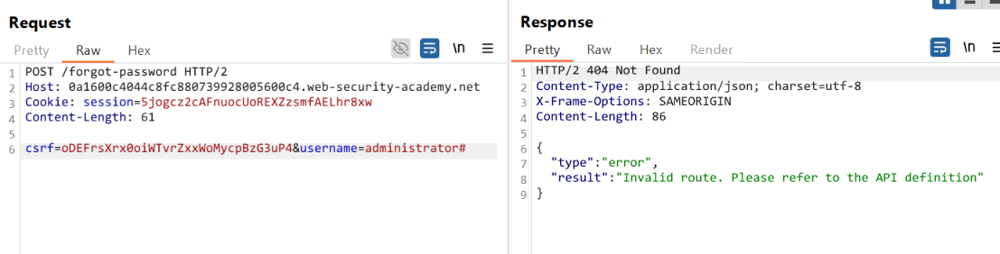

Thực hiện test các hành vi khác:
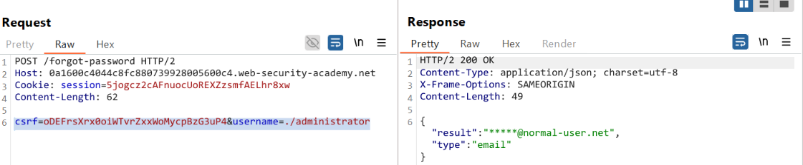
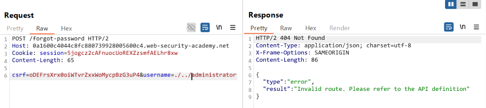
Chèn các kí tự `./` thì không bị gì còn chèn `../../` lại bị lỗi định tuyến ==> dạng cây truy vấn ở internal có thể dạng `/api/v2/heheh/{input_user}/someThing/` vậy thử tìm các endpoint document . BE sử dụng các công nghệ có khả năng chuẩn hóa URL trước khi gửi request đến internal API.

thực hiện fuzzing để tìm  document.
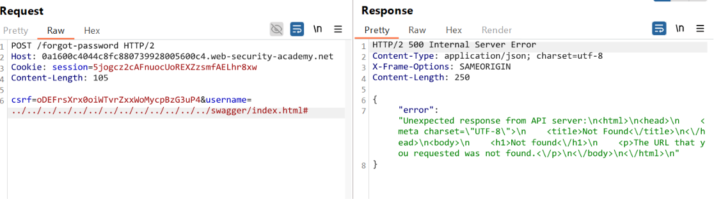
Nhận thấy server vẫn xử lý nhưng không có endpoint nên trả về not found.
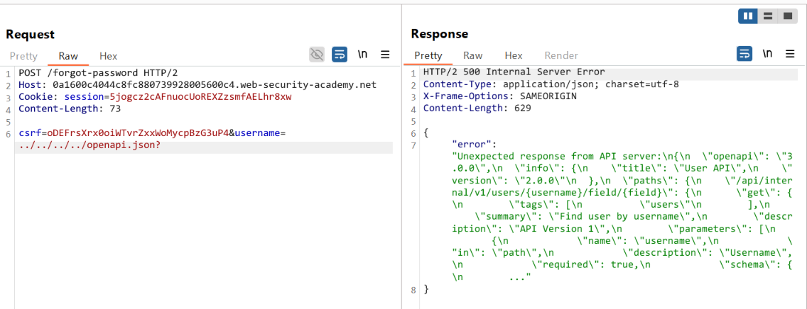
Đã tìm thấy một API document.
```json

{
  "openapi": "3.0.0",
  "info": {
    "title": "User API",
    "version": "2.0.0"
  },
  "paths": {
    "/api/internal/v1/users/{username}/field/{field}": {
      "get": {
        "tags": [
          "users"
        ],
        "summary": "Find user by username",
        "description": "API Version 1",
        "parameters": [
          {
            "name": "username",
            "in": "path",
            "description": "Username",
            "required": true,
            "schema": {
              "type": "string"
            }
          },
          {
            "name": "field",
            "in": "path",
            "description": "User field to retrieve",
            "required": true,
            "schema": {
              "type": "string"
            }
          }
        ]
      }
    }
  }
}

```
Từ mô tả của api thì `field` là trường sẽ được truy vấn đến trả thông tin về.Ở `/static/js/forgotPassword.js` có để lộ `passwordResetToken` param

Payload lấy token:
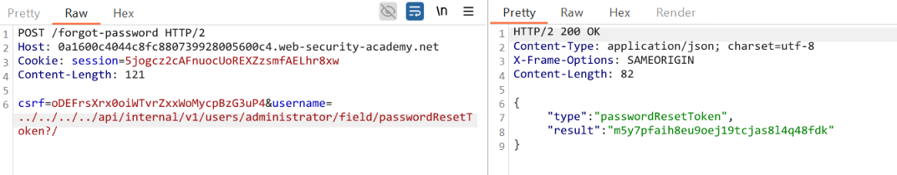

