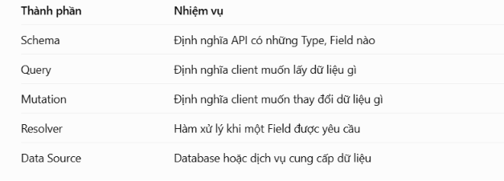
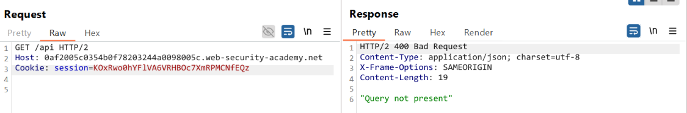

## reference
https://www.geeksforgeeks.org/graphql/introspection-in-graphql/

https://portswigger.net/web-security/graphql/what-is-graphql
Đọc hiểu các lý thuyết về những thứ trên trước 

introspection thì đọc cái [nay](https://portswigger.net/burp/documentation/desktop/testing-workflow/working-with-graphql#accessing-graphql-api-schemas-using-introspection) để burp tự động viết truy vấn.

[InQL](https://portswigger.net/bappstore/296e9a0730384be4b2fffef7b4e19b1f)


## Lý thuyết
introspection thường thu thập các thông tin như:
- Query type: tên type gốc chứa các Query.
- Fields: các operation/field mà client có thể gọi.
- Arguments: tham số đầu vào của từng field.
- Return type: kiểu dữ liệu mà field trả về.
- Fields của return type: dữ liệu có thể yêu cầu server trả về cho client.



`Object Type`: Đơn vị cơ bản nhất, đại diện cho một đối tượng có các trường (fields) dữ liệu.

`Scalar Type`: Các kiểu dữ liệu cơ sở (nguyên thủy)

`Special Root Types`: Các kiểu dữ liệu đặc biệt làm điểm bắt đầu cho mọi yêu cầu:
- `Query`: Lấy dữ liệu (tương đương GET trong REST).
- `Mutation`: Thay đổi dữ liệu (tương đương POST, PUT, DELETE).
- `Subscription`: Đăng ký lắng nghe sự kiện theo thời gian thực (Real-time qua WebSocket).

**Định nghĩa một Type**
```
# 1. Object Type: Định nghĩa đối tượng Người dùng
type User {
  id: ID!             # Ký hiệu ! nghĩa là BẮT BUỘC (non-null)
  name: String!
  email: String!
  role: Role!
  age: Int
  posts: [Post!]!     # Danh sách các bài viết của người dùng
}

# 2. Object Type: Định nghĩa đối tượng Bài viết
type Post {
  id: ID!
  title: String!
  content: String!
  published: Boolean!
  author: User!       # Liên kết tới Object Type User
}

# 3. Root Query Type: Điểm truy vấn dữ liệu
type Query {
  getUser(id: ID!): User
  getAllPosts: [Post!]!
}

# 4. Root Mutation Type: Điểm thay đổi dữ liệu
type Mutation {
  createUser(input: CreateUserInput!): User!
  deletePost(id: ID!): Boolean!
}
```
**Định nghĩa schema(Gồm các type và filed ở trên)**
```javascript
const typeDefs = `#graphql
  enum Role {
    USER
    ADMIN
  }

  input CreateUserInput {
    name: String!
    email: String!
    role: Role = USER
  }

  # 1. Object Type: Định nghĩa đối tượng Người dùng
  type User {
    id: ID!             # Ký hiệu ! nghĩa là BẮT BUỘC (non-null)
    name: String!
    email: String!
    role: Role!
    age: Int
    posts: [Post!]!     # Danh sách các bài viết của người dùng
  }

  # 2. Object Type: Định nghĩa đối tượng Bài viết
  type Post {
    id: ID!
    title: String!
    content: String!
    published: Boolean!
    author: User!       # Liên kết tới Object Type User
  }

  # 3. Root Query Type: Điểm truy vấn dữ liệu
  type Query {
    getUser(id: ID!): User
    getAllPosts: [Post!]!
  }

  # 4. Root Mutation Type: Điểm thay đổi dữ liệu
  type Mutation {
    createUser(input: CreateUserInput!): User!
    deletePost(id: ID!): Boolean!
  }
`;
```

### introspection
**Tính năng này nên tắt ở môi trường product**
```
const server = new ApolloServer({
  typeDefs,
  resolvers,

  // Chỉ bật Introspection ở môi trường development
  introspection: process.env.NODE_ENV !== "production"
});
```

**1. __schema**
introspection để trả về các type được định nghĩa ở schema

```
query {
  __schema {
    types {
      name
    }
  }
}
```
Truy vấn các root type của Query , Mutation , Subscription
```
query {
    __schema {
        mutationType {
            name
        }
    }
}
# thay mutation bằng subscription , query , subscription .
```
**2. __type**
Phân tích chi tiết một Object Type sau khi đã tìm thấy nó bằng `__schema`.
```
query {
    __type(name: "<TYPE_NAME>") {
        name
        kind      # loại dữ liệu
        fields {
            name  # tên các trường của 1 type
            kind  # loại dữ liệu
        }
    }
}
```

## Lab
### 1.Lab: Accessing private GraphQL posts
Bắt request chuyển sang tab Repeater --> GraphQL --> Set introspection query:
- Set introspection query: Tự động chèn câu lệnh Introspection Query chuẩn hiện đại vào ô Query
- Set legacy introspection query: Tự động chèn câu lệnh Introspection dạng cũ (dành cho các GraphQL server đời cũ không hỗ trợ cú pháp mới)

Thực hiện introspection để tìm hiểu api --> dùng query để lấy scret.
```
{
    "query": "query { getBlogPost(id: 1) { id title isPrivate postPassword } }"
}
```

### 2. Lab: Accidental exposure of private GraphQL fields

Sử dungj InQL để phân tích và introspection để tìm hiểu chema cua API.Trang WEB dính lỗ hổng IDOR khi mà user khác cũng có thể sử dụng query GetUser để lấy thông tin của user khác

### 3. Lab: Finding a hidden GraphQL endpoint
thực hiện fuzzing các  endpoint suffixes cảu GraphQL endpoint nhận thấy /api "Query not present" thì khả năng đây là endpoint yêu cầu 1 query được truyền vào 


Thực hiện thử query `__schema` thì nhìn thấy báo lỗi ==> không tắt introspection ở product.

